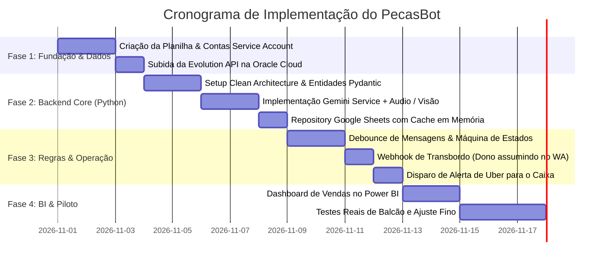

# PecasBot: Plano Mestre de Engenharia & Documentação Técnica
## Sistema Autônomo de Vendas, Cotação e Expedição de Peças via WhatsApp

---

## 📑 Índice da Suíte de Documentação (Google-Grade RFCs)

Para estruturar este projeto com o rigor de engenharia das grandes empresas de tecnologia, o plano foi dividido em 4 documentos arquiteturais complementares:

1. 📘 [PRD-001: Especificação de Requisitos de Produto](file:///home/robson/.gemini/antigravity-ide/brain/8854bd0d-40f1-4d41-a962-8ec416442d98/01_product_requirements_document.md)
   * Visão do negócio, dores do proprietário e personas.
   * Regras para o **despacho via Uber Flash operado pelos meninos do caixa**.
   * Resolução proativa de ambiguidades técnicas (com aro vs. sem aro, original vs. paralela).
   * Matriz de transbordo humano silencioso (handoff).

2. 🏗️ [RFC-002: Arquitetura de Software & Design Técnico](file:///home/robson/.gemini/antigravity-ide/brain/8854bd0d-40f1-4d41-a962-8ec416442d98/02_technical_architecture_design.md)
   * Princípios de **Clean Architecture** e **DDD** (Entidades puras desacopladas de frameworks).
   * Máquina de estados da conversação (`AI_ACTIVE`, `HUMAN_ACTIVE`, `WAITING_DISPATCH`).
   * Diagrama de sequência de ponta a ponta (Áudio $\rightarrow$ Gemini $\rightarrow$ Sheets $\rightarrow$ Alerta Caixa).
   * Padrões de resiliência e in-memory cache para o Google Sheets.

3. 📊 [RFC-003: Esquema de Dados, Integrações & Prompts](file:///home/robson/.gemini/antigravity-ide/brain/8854bd0d-40f1-4d41-a962-8ec416442d98/03_data_schema_and_integrations.md)
   * Schemas das 3 abas da planilha compatíveis com **Power BI** e **Looker Studio**.
   * Contratos de payload da **Evolution API** (mensagens de texto, áudio e interceptação do dono).
   * Engenharia de prompts para o **Google Gemini Flash** com tom de balcão amigo.
   * Declaração de Function Calling / Tools para consulta de estoque e alerta de separação.

4. 🚀 [RFC-004: Guia de Infraestrutura, DevOps & Implantação](file:///home/robson/.gemini/antigravity-ide/brain/8854bd0d-40f1-4d41-a962-8ec416442d98/04_infrastructure_and_deployment.md)
   * Topologia de rede na **Oracle Cloud Always Free (12GB RAM)** a custo R$ 0,00.
   * `docker-compose.yml` pronto orquestrando Evolution API v2, Redis e FastAPI.
   * Runbook operacional de emparelhamento do WhatsApp e rotinas de logs.

---

## 🗺️ Roadmap de Execução por Fases

