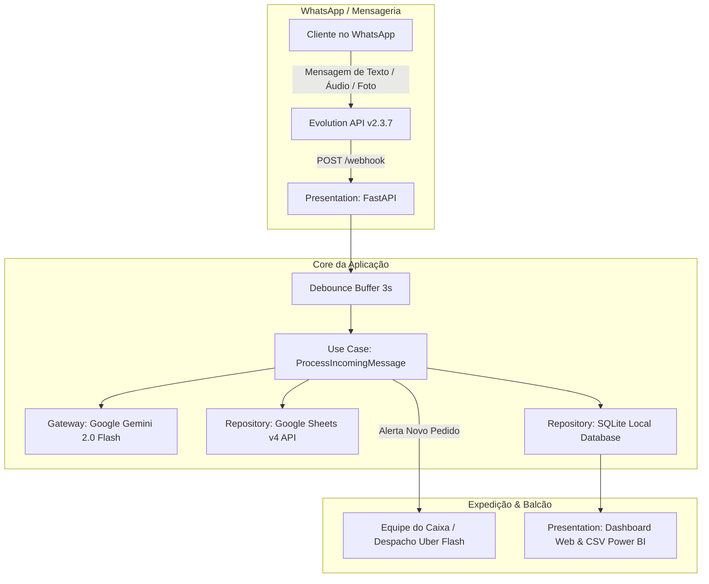
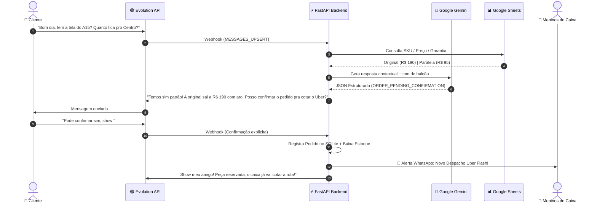

# 📱 Victor Cell Autobot — Sistema Autônomo de Vendas, Cotação & Expedição de Peças via WhatsApp

<p align="center">
  
  
  
  
  
  
  
</p>

---

## 📖 Visão Geral Executiva

O **Victor Cell Autobot** é uma plataforma de inteligência artificial conversacional e automação operacional projetada sob medida para lojas de peças de smartphones e tablets no comércio de balcão físico e digital.

Construído sob os princípios de **Clean Architecture (Arquitetura Limpa)** e **Domain-Driven Design (DDD)**, o sistema integra o motor de IA **Google Gemini (2.0 Flash / 1.5 Flash)** ao WhatsApp através da **Evolution API v2**, utilizando o **Google Sheets** como banco de catálogo vivo e um **Dashboard Executivo Web** para acompanhamento de faturamento, pedidos e expedição via **Uber Flash**.

### 🎯 Principais Diferenciais de Engenharia
* **Voz de Balcão Cearense & Naturalidade:** Atendimento consultivo, amigável e descontraído (*"Opa meu patrão!", "Temos sim, chefia!"*), eliminando completamente menus mecânicos numéricos (*"Digite 1 para telas..."*).
* **Transparência Técnica Proativa:** Diferenciação automática entre peças **Original Nacional** (com aro, 90 dias de garantia) e **Paralela / China Incell** (sem aro, preço acessível, recomendação de teste antes de colar).
* **Fluxo de Confirmação em 2 Etapas (Anti-Falso Positivo):** Cotações de frete e perguntas de endereço não geram reservas acidentais no estoque. O pedido só é registrado após confirmação explícita do cliente (*"Pode confirmar"*, *"Pode separar"*).
* **Transbordo Humano Silencioso & Reativação em 1 Clique:** Quando o atendente humano responde no WhatsApp Web ou celular, a IA é **silenciada automaticamente por 3 horas**. A reativação pode ser feita silenciosamente com **1 clique no Painel** ou por frases naturais (*"Vou te passar pro sistema"*), sem expor comandos feios como `#bot` ao cliente.
* **Google Sheets como Single Source of Truth:** Alterações de preços e novas peças cadastradas na planilha são refletidas imediatamente via API Google Sheets v4 com cache inteligente em memória.
* **Painel Executivo Web Integrado:** Dashboard em Dark Theme (Glassmorphism), relógio ao vivo no fuso de Fortaleza (`GMT-3`), monitor de cotas Gemini, e botão de exportação **CSV para Power BI / Excel** embutido na tabela de expedição.
* **Custo R$ 0,00 de Infraestrutura:** 100% conteinerizado e implantado na **Oracle Cloud Infrastructure (OCI) Always Free**.

---

## 📐 Arquitetura do Sistema

O projeto segue estritamente a separação em camadas da **Clean Architecture**, garantindo testabilidade isolada e desacoplamento de frameworks externos:



### Diagrama de Sequência de Atendimento



---

## 🗂️ Estrutura de Diretórios

```
victor-cell-autobot/
├── application/
│   └── use_cases/
│       ├── debounce_buffer.py            # Agregador de mensagens rápidas (janela de 3s)
│       └── process_incoming_message.py   # Orquestrador central e máquina de estados
├── domain/
│   ├── entities.py                       # Entidades puras (Product, Conversation, Order)
│   ├── gateways.py                       # Interfaces abstratas de Mensageria e IA
│   └── repositories.py                   # Interfaces abstratas de Banco de Dados e Estoque
├── infrastructure/
│   ├── config.py                         # Settings (Pydantic), fuso horário Fortaleza, horário comercial
│   ├── gateways/
│   │   └── evolution_gateway.py          # Cliente HTTP da Evolution API v2 e alertas ao caixa
│   ├── repositories/
│   │   ├── google_sheets_repository.py   # Leitura ao vivo da planilha oficial Google Sheets v4
│   │   ├── sqlite_repository.py          # Persistência de histórico, pedidos e proteção anti-eco
│   │   ├── sheets_exporter.py            # Exportador de relatório compatível com Power BI (.csv)
│   │   └── memory_product_repository.py  # Mock em memória para testes unitários
│   └── services/
│       └── agent_service.py              # Integração Google GenAI (Gemini) + Fallback Semântico
├── presentation/
│   ├── api.py                            # Endpoints REST e Webhooks da Evolution API
│   └── dashboard.py                      # Painel Executivo Web Dark Mode (HTML/JS/Chart.js)
├── data/                                 # Volume persistente do SQLite (pecasbot.db)
├── docs/                                 # RFCs e especificações técnicas de engenharia
├── tests/                                # Suíte de testes automatizados com Pytest
├── docker-compose.yml                    # Orquestração completa de microsserviços
├── Dockerfile                            # Imagem otimizada Python 3.13 Slim
├── requirements.txt                      # Dependências de produção
└── pyproject.toml                        # Configuração de linters (Ruff) e testes
```

---

## 🌟 Funcionalidades Detalhadas

### 1. Tom de Voz Cearense & Balcão Especializado
* Tratamento natural: *"Opa meu amigo"*, *"Temos sim, patrão!"*, *"Beleza, chefia?"*.
* Nunca expõe códigos internos ou JSON para o cliente.
* Explicação das diferenças entre telas com clareza técnica:
  * **Original Nacional:** Aro incluso, brilho de fábrica, taxa de touch original, 90 dias de garantia.
  * **Paralela / China Incell:** Sem aro, excelente custo-benefício, recomendação expressa de testar na bancada antes de colar.

### 2. Máquina de Estados & Confirmação em Duas Etapas
O sistema evita falsos positivos através do enum `ConversationState`:
1. `AI_ACTIVE`: Conversa livre para tirar dúvidas, cotações de preços e modelos.
2. `WAITING_CONFIRMATION`: O cliente passou um endereço ou perguntou sobre entrega. A IA pré-anota o endereço e pergunta: *"Posso confirmar a reserva da peça no valor de R$ X e passar pros meninos do caixa cotarem o Uber Flash?"*.
3. `WAITING_DISPATCH`: O cliente respondeu explicitamente que sim (*"Pode confirmar"*, *"Separa aí"*). O pedido é gravado no SQLite, o estoque é deduzido, a equipe do caixa recebe alerta no WhatsApp com endereço e rota, e a reserva ganha validade de 2 horas.
4. `HUMAN_ACTIVE`: Atendente humano assumiu o chat. A IA permanece silenciada.

### 3. Mecanismo de Transbordo Humano (*Human Takeover*)
* **Anti-Eco / Loop Protection:** Mensagens enviadas pelo próprio robô são registradas na tabela `sent_messages`. Quando a Evolution API devolve o webhook `fromMe: true`, o sistema detecta se foi mensagem da IA ou do atendente humano.
* **Silêncio de 3 Horas:** Se o atendente humano da loja digitar no WhatsApp Web ou no celular pessoal, a IA é **silenciada automaticamente por 3 horas** para aquele cliente.
* **Reativação Silenciosa:** O atendente pode reativar a IA a qualquer momento através do **botão no Dashboard Executivo** ou digitando uma frase natural como *"Vou te passar pro sistema"*. O cliente nunca vê comandos como `#bot`.

### 4. Dashboard Executivo & Inteligência de Dados
Acessível diretamente em `http://<IP_DO_SERVIDOR>:8005/dashboard`:
* **5 Abas de Navegação:**
  1. **📊 Visão Geral:** KPIs de faturamento acumulado, ticket médio, total de pedidos, % de entregas via Uber Flash e Simulador em tempo real.
  2. **📦 Expedição & Pedidos:** Tabela de pedidos com links diretos para chamar no WhatsApp (`https://wa.me/...`), status de separação e **botão embutido de Download do CSV para Power BI / Excel**.
  3. **📋 Catálogo Google Sheets:** Visualização em tempo real das peças cadastradas na planilha com botão de **Forçar Sincronização**.
  4. **📈 Inteligência de Vendas:** Ranking das peças mais procuradas (🥇 🥈 🥉), gráficos Chart.js (Original vs Paralela) e intenções mais frequentes dos técnicos.
  5. **⚡ IA Gemini & Cotas:** Visualizador de limites da API (RPM/RPD), links para monitoramento e campo para **atualizar a chave Gemini em 1 clique sem SSH**.

---

## 🔌 Tabela de Endpoints da API

| Método | Endpoint | Descrição |
| :--- | :--- | :--- |
| `GET` | `/dashboard` | Interface gráfica do Painel Executivo Web |
| `GET` | `/health` | Liveness probe do backend (status, hora de Fortaleza, expediente) |
| `POST` | `/webhook` | Receptor de eventos da Evolution API (`MESSAGES_UPSERT`) |
| `GET` | `/api/reports/stats` | JSON com KPIs, top produtos, gráficos e pedidos recentes |
| `GET` | `/api/reports/orders.csv` | Download do arquivo CSV compatível com Power BI |
| `POST` | `/api/reports/sync-sheets` | Força a invalidação do cache e recarga do Google Sheets |
| `GET` | `/api/catalog` | Lista completa das peças ativas lidas da planilha |
| `GET` | `/api/conversations` | Lista conversas ativas e status de silêncio da IA |
| `POST` | `/api/conversations/{phone}/resume` | Reativa a IA de um cliente silenciosamente via dashboard |
| `POST` | `/api/conversations/{phone}/pause` | Pausa a IA manualmente por 3 horas via dashboard |
| `GET` | `/api/ai/quota-info` | Exibe modelo ativo, chave mascarada e limites de requisições |
| `POST` | `/api/ai/update-key` | Atualiza e valida nova chave do Gemini em tempo de execução |
| `POST` | `/api/simulator/chat` | Simulador para testes rápidos de perguntas diretamente na tela |
| `GET` | `/api/whatsapp/qrcode` | Busca status de conexão ou QR Code atual da Evolution API |

---

## 🚀 Guia de Implantação e Execução

### Pré-requisitos
* **Docker & Docker Compose** instalados.
* Chave de API do **Google Gemini** ([Google AI Studio](https://aistudio.google.com/app/apikey)).
* Planilha do **Google Sheets** com a aba `Estoque` configurada e chave pública de API.

### 1. Configuração do Ambiente (.env)
Copie o modelo de variáveis de ambiente:
```bash
cp .env.example .env
```

Edite o arquivo `.env` com as configurações da loja:
```env
# Google Gemini API
GEMINI_API_KEY="AIzaSy..."

# Google Sheets Integration
GOOGLE_SHEET_ID="1N2gigR8MmuiBRSbtO1TDLnS9AFQS3dJYhxYEEUs7kZY"
GOOGLE_SHEETS_API_KEY="AIzaSy..."

# Evolution API v2
EVOLUTION_API_URL="http://victor_cell_evolution:8080"
EVOLUTION_API_KEY="victorcell_secret_token_2026"
EVOLUTION_INSTANCE_NAME="victor-cell-01"

# Horário de Funcionamento (Fuso Fortaleza GMT-3)
STORE_TIMEZONE="America/Fortaleza"
STORE_OPENING_TIME="08:30"
STORE_CLOSING_TIME="18:00"

# Telefones do Caixa / Expedição para Alertas de Uber Flash
STAFF_PHONES="5585991497037"
```

### 2. Execução Local com Docker Compose
Para subir toda a infraestrutura (Backend + Evolution API + PostgreSQL + Redis):
```bash
docker compose up -d --build
```

Verifique se todos os contêineres estão operacionais:
```bash
docker ps
```
Você verá:
* `victor_cell_backend` (Porta `8005`)
* `victor_cell_evolution` (Porta `8085`)
* `victor_cell_postgres` (Interno)
* `victor_cell_redis` (Interno)

### 3. Conectando o WhatsApp da Loja
1. Abra o navegador em: `http://localhost:8005/dashboard` (ou no IP da sua VM na nuvem).
2. Clique no botão **`📱 WhatsApp QR`** no topo direito.
3. No celular da loja, abra o WhatsApp $\rightarrow$ **Aparelhos Conectados** $\rightarrow$ **Conectar um Aparelho**.
4. Aponte a câmera para o QR Code na tela. O status mudará imediatamente para `🟢 WhatsApp Conectado`.

---

## ☁️ Topologia de Nuvem: Oracle Cloud Always Free

O projeto está implantado em uma máquina virtual Compute na **Oracle Cloud (Região Vinhedo/SP ou Ashburn)** configurada com:
* **SO:** Ubuntu 22.04 LTS (Kernel Linux 7.0 Oracle)
* **Recursos:** 2 OCPUs, 12 GB RAM (dentro da cota 100% gratuita perpétua).
* **Firewall / Ingress Rules:**
  * Porta `8005` liberada para o Dashboard e Webhook.
  * Porta `8085` liberada para o painel de gerenciamento da Evolution API.

### Atualização Contínua em Produção
Para atualizar a aplicação na nuvem com as últimas alterações do Git:
```bash
ssh -i seu-ssh-key.key ubuntu@161.153.2.148
cd /home/ubuntu/victor-cell-autobot
git pull origin main
docker compose up -d --build pecas-backend
```

---

## 🧪 Testes Automatizados

O projeto possui cobertura de testes unitários e de integração utilizando `pytest` e `pytest-asyncio`:

```bash
# Executar a suíte de testes
pytest tests/ -v
```

Os testes cobrem:
* Criação e validação das entidades de domínio e regras de negócio.
* Agrupamento de mensagens no `DebounceBuffer`.
* Transbordo de atendimento humano e expiração da janela de 3 horas.
* Proteção contra loops de auto-resposta (*anti-echo*).

---

## 🛡️ Observabilidade & Monitoramento de Cotas

### Como funcionam os limites da API do Google Gemini
1. **Google AI Studio (Plano Gratuito):**
   * **15 RPM:** Até 15 requisições por minuto.
   * **20 a 1.500 RPD:** Cota diária conforme o vínculo com o projeto do Google Cloud.
   * Quando o limite diário de 20 requisições do plano gratuito é atingido, o robô entra automaticamente em **Modo de Fallback Semântico** para manter o atendimento ativo com as regras de balcão pré-programadas.
2. **Plano Comercial (Pay-as-you-go):**
   * Vinculando uma conta de faturamento no GCP, o limite sobe para **1.000 requisições por minuto sem nenhum teto diário**.
   * No modelo `gemini-2.0-flash`, o custo médio é de apenas **R$ 0,0005 por conversa** (centavos de real por mês).

Acompanhe o consumo oficial em tempo real em:
👉 [ai.dev/rate-limit](https://ai.dev/rate-limit) | [aistudio.google.com/app/plan_information](https://aistudio.google.com/app/plan_information)

---

## 📄 Licença

Distribuído sob a licença **MIT**. Consulte `LICENSE` para obter mais detalhes.

---

<p align="center">
  <b>Victor Cell • Peças para Celulares e Tablets</b><br>
  Desenvolvido com excelência técnica de nível global.
</p>
