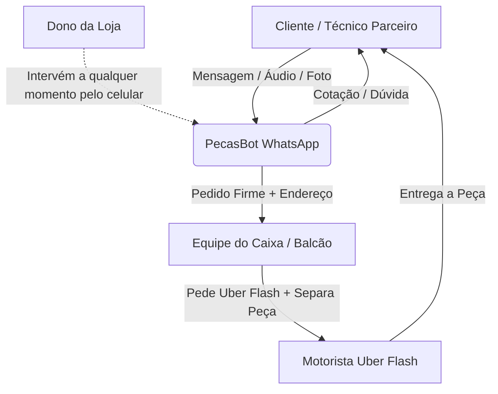

# PRD-001: Especificação de Requisitos de Produto (PRD)
## Agente Autônomo de Vendas e Despacho de Peças via WhatsApp

---

| Metadado | Detalhe |
| :--- | :--- |
| **Projeto** | Assistente Autônomo de Balcão e Expedição (PecasBot) |
| **Versão** | 1.0.0 (RFC - Design Fase 1) |
| **Status** | Aprovado para Arquitetura |
| **Público-Alvo** | Assistências Técnicas, Técnicos Autônomos e Consumidores Finais |
| **Stack Principal** | Python (FastAPI), Google Gemini 1.5/2.0 Flash, Google Sheets, Evolution API |

---

## 1. Visão do Produto & Declaração do Problema

### 1.1 Contexto e Dor do Negócio
O proprietário da loja de peças de reposição (telas, conectores de carga, carcaças, baterias e acessórios de tablets e smartphones) gasta entre 4 a 6 horas diárias respondendo mensagens repetitivas no WhatsApp. Esse volume contínuo de mensagens afeta seu tempo familiar e cria um gargalo no fluxo de vendas:
1. O técnico de bancada tem urgência e cota a mesma peça com 2 ou 3 fornecedores simultâneos. Quem responder com precisão em menos de 1 minuto fecha o pedido.
2. Chatbots convencionais de árvore de decisão (*"Digite 1 para telas, digite 2 para conectores"*) destroem a relação de confiança e causam taxa de abandono superior a 70% entre técnicos experientes.
3. A loja opera com entregas rápidas via **Uber Flash**, onde **a própria equipe do caixa da loja realiza a cotação e o pedido do Uber**, adicionando a corrida à conta do cliente ou combinando o frete.

### 1.2 Objetivo Estratégico
Automatizar 80% das interações receptivas de WhatsApp com **atendimento contextual humanizado**, mantendo rastreabilidade total em tempo real (para alimentação de dashboards gerenciais em Power BI / Looker Studio) e garantindo transbordo transparente e imediato para intervenção humana sempre que necessário.

---

## 2. Personas do Ecossistema



1. **Técnico Parceiro (B2B):**
   * Perfil: Pragmático, apressado, envia áudios curtos ou jargões (*"salva uma tela a15 nacional com aro"*).
   * Necessidade: Saber se tem a peça, o preço, se é original ou paralela e a confirmação rápida de que está separada.

2. **Equipe do Caixa / Expedição (Usuário Operacional Interno):**
   * Perfil: Funcionários no balcão da loja física cuidando de clientes presenciais e montando pacotes.
   * Papel no fluxo: Receber notificação interna do bot com nome do cliente, peça separada e endereço de entrega; cotar e chamar o Uber Flash; entregar o pacote lacrado ao motorista.

3. **Proprietário / Gestor:**
   * Papel: Deseja ter a liberdade de assumir a conversa pelo próprio celular a qualquer momento e visualizar o funil diário em dashboards (peças cotadas vs. faturadas).

---

## 3. Regras de Negócio Fundamentais

### 3.1 Tratamento de Ambiguidade de Peças
Telas e conectores possuem sutilezas técnicas críticas. O agente não deve confirmar pedidos sem sanar três pilares:
* **Com Aro vs. Sem Aro:** Se o cliente pedir apenas *"tela A15"*, o agente deve checar o catálogo e perguntar objetivamente: *"Você prefere com aro ou sem aro?"*.
* **Qualidade / Procedência:** Deve ser 100% transparente:
  * **Original Nacional / Service Pack:** Maior valor, garantia de 90 dias.
  * **Primeira Linha / Incell / China:** Custo mais acessível, aviso de teste antes de colar.
* **Modelo exato de Tablet:** Linhas Samsung Tab possuem variações de conectores (ex: Tab A8 X200 Wi-Fi vs X205 4G). O agente deve confirmar o código do modelo caso haja divergência de compatibilidade.

### 3.2 O Fluxo de Despacho via Uber Flash (Operado pelo Caixa)
> [!IMPORTANT]
> A responsabilidade de solicitar o Uber Flash é **exclusiva da equipe de caixa da loja**, e não do cliente.

1. **Intenção de Entrega Detectada:** Quando o cliente expressa *"pode mandar entregar"* ou *"manda por Uber"*:
   * O agente solicita a confirmação do endereço completo (Rua, Número, Bairro e Ponto de Referência).
2. **Notificação Imediata da Expedição:** O bot dispara uma mensagem formatada para o grupo de WhatsApp interno dos funcionários:
   ```text
   📦 NOVO DESPACHO VIA UBER FLASH REQUISITADO
   • Cliente: AutoTech Celulares (85 99123-4567)
   • Peça: Tela Frontal Galaxy A15 c/ aro - Original (R$ 190,00)
   • Endereço: Rua Floriano Peixoto, 1250 - Centro
   • Ação da Loja: Cotar Uber Flash, somar valor e avisar o cliente.
   ```
3. **Comunicação com o Cliente:**
   * O bot orienta: *"Perfeito! Já passei o seu endereço para os meninos do caixa cotarem o Uber Flash. Em instantes eles informam o valor do frete e a chave Pix para liberação imediata!"*.

### 3.3 Debounce de Mensagens (Janela de Espera)
Para combater mensagens fragmentadas comuns no WhatsApp (ex: 4 mensagens enviadas em 10 segundos):
* O sistema cria um buffer de **6 segundos** após a última mensagem recebida.
* Mensagens de texto subsequentes, áudios e imagens recebidos na janela são agregados em uma única solicitação para o Gemini.

### 3.4 Matriz de Horário de Atendimento
* **Horário Comercial (Seg a Sex: 08:30 às 18:00 | Sáb: 08:30 às 13:00):**
  * Respostas em tempo real, confirmação de separação imediata e acionamento do caixa.
* **Fora do Horário Comercial:**
  * O bot atende cordialmente, tira dúvidas de preços e modelos, mas condiciona a separação:
  * *"Consultei aqui e temos a peça sim! Como nossa expedição física abre amanhã às 08h30, posso deixar seu pedido na fila de separação para os meninos despacharem na primeira hora?"*.

---

## 4. Matriz de Transbordo Humano (Human Handoff)

A transição da IA para o atendente humano deve ocorrer de forma fluida e sem gerar fricção:

| Gatilho | Ação do Sistema | Resposta ao Cliente |
| :--- | :--- | :--- |
| **Dono ou funcionário envia mensagem no chat** (`fromMe: true`) | Pausa a IA na conversa por 3 horas. Registra log `STATE = HUMAN_ACTIVE`. | Nenhuma (o humano já está digitando). |
| **Cliente pede desconto agressivo ou negociação** | Alerta a conversa com tag `Negociação Pendente` e notifica o dono. | *"Vou verificar essa condição especial direto com o gerente e já te damos um retorno aqui, só um minuto!"* |
| **Reclamação de garantia, defeito ou devolução** | Pausa a IA imediatamente e alerta o setor de trocas. | *"Compreendo perfeitamente. Já acionei nosso setor de garantias para verificar seu caso com prioridade."* |
| **Peça não cadastrada na planilha** | Notifica a equipe de compras para verificar estoque físico não tabelado. | *"Não localizei esse modelo específico na minha lista rápida. Já pedi para os meninos olharem direto na prateleira física e te aviso em breve!"* |
| **Comando manual de reativação** | Dono digita `#bot` na conversa. Reativa a IA instantaneamente. | Silencioso / Sistema reativado. |

---

## 5. Rastreabilidade & Indicadores de Negócio (BI)

Toda interação deve persistir dados suficientes para alimentar dashboards gerenciais (Looker Studio / Power BI):

1. **Volume de Demanda por Fabricante e Modelo:** Quais telas são as mais pesquisadas da semana.
2. **Taxa de Conversão de Cotações:** Percentual de cotações que evoluíram para pedido de separação.
3. **Métricas de Demanda Reprimida:** Quantas buscas resultaram em estoque zerado (oportunidade de compra de reposição de estoque).
4. **Volume de Despachos por Região/Bairro:** Mapeamento de quais assistências compram com maior frequência.
