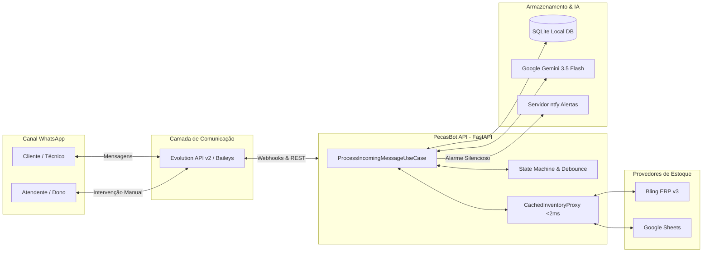

# PRD-001: Especificação de Requisitos de Produto (Product Requirements Document)
## Sistema Autônomo de Atendimento, Cotação e Despacho de Peças via WhatsApp (PecasBot)

---

### Metadados do Documento

| Atributo | Definição |
| :--- | :--- |
| **Identificador** | PRD-001-PECSBOT |
| **Organização** | Victor Cell (Fortaleza/CE) |
| **Autor** | Staff Technical Product Manager / Engenharia de Requisitos |
| **Padrão de Especificação** | Google Engineering Documentation Standard (RFC/PRD) |
| **Versão** | 2.1.0 (Produção Homologada) |
| **Status** | Aprovado para Produção |
| **Classificação** | Técnico / Operacional Interno |
| **Stack de Referência** | Python 3.13 (FastAPI), Google Gemini 3.5 Flash, SQLite3, Bling ERP v3, Google Sheets |

---

## 1. Declaração do Problema e Contexto Estratégico

### 1.1 Contexto Operacional
A Victor Cell é uma distribuidora e assistência especializada sediada em Fortaleza/CE, cujo modelo de negócio concentra-se exclusivamente no fornecimento de peças de reposição (telas, módulos display, vidros touch, conectores de carga, baterias e periféricos) para **tablets**. 

O principal canal de aquisição e relacionamento com clientes corporativos (técnicos de bancada, donos de assistências terceirizadas e lojistas) é o WhatsApp. O canal opera sob regime de alta volatilidade e sensibilidade temporal:
1. **Janela Crítica de Conversão:** Técnicos de bancada cotam componentes simultaneamente com 2 a 4 fornecedores locais. A probabilidade de fechamento atinge o ápice quando a resposta com valor e disponibilidade ocorre em menos de 60 segundos.
2. **Inadequação de Chatbots Convencionais (IVR/Árvores):** Soluções automatizadas baseadas em menus numéricos ("Digite 1 para telas, 2 para baterias") geram taxa de rejeição superior a 72% entre técnicos profissionais, que demandam interação ágil e direta.
3. **Logística de Despacho (Uber Flash):** A loja viabiliza entregas intraurbanas imediatas via Uber Flash. A responsabilidade de conferência de endereço, solicitação do motorista e consolidação da cobrança recai sobre a equipe interna de expedição e balcão.

### 1.2 Formulação do Problema
O atendimento puramente manual gera sobrecarga de 4 a 6 horas diárias da liderança técnica em triagens repetitivas, lentidão no fechamento de pedidos em horários de pico e perda total de demanda fora do expediente comercial e aos domingos. 

Por outro lado, agentes de inteligência artificial generativa desprovidos de restrições formais tendem à prolixidade, alucinações de preço, adoção de tom excessivamente robótico e quebra da confiança do cliente técnico.

### 1.3 Visão do Produto
Implantar um agente conversacional autônomo, determinístico em suas regras de negócio e adaptativo em sua cognição semântica, operando sob a identidade estrita de um **atendente humano de balcão de assistência técnica**. O agente deve operar com respostas ultra-curtas (1 a 6 palavras), acurácia de 100% no catálogo de tablets, transbordo silencioso imediato em cenários de incerteza e integração resiliente com ERP e planilhas de estoque.

---

## 2. Objetivos do Produto e Métricas de Sucesso (OKRs / KPIs)

### 2.1 Objetivos de Negócio
- **OBJ-01:** Reduzir em 80% o tempo dedicado pela equipe humana à triagem de cotações repetitivas de peças em estoque.
- **OBJ-02:** Zerar o tempo de resposta em horário comercial (latência de resposta ponta a ponta inferior a 3 segundos).
- **OBJ-03:** Capturar demanda reprimida aos finais de semana e fora do horário de funcionamento sem violar os horários reais de expedição física.

### 2.2 Métricas Chave de Desempenho (KPIs)

| Indicador | Definição | Meta de Produção |
| :--- | :--- | :--- |
| **Latência P95 de Resposta** | Tempo decorrido entre o fim do debounce e a postagem da resposta no WhatsApp. | $\le 2.500\text{ ms}$ |
| **Taxa de Alucinação de Preço** | Frequência de divergência entre o valor cotado e o repositório oficial de inventário. | $0{,}00\%$ (Tolerância Zero) |
| **Precisão de Escopo (Tablets)** | Bloqueio imediato de consultas de celulares, vestíveis e notebooks. | $100{,}00\%$ |
| **Aderência ao Padrão de Concisão** | Proporção de mensagens geradas contendo entre 1 e 6 palavras (fora fechamento). | $\ge 95{,}00\%$ |
| **Disponibilidade da API (Uptime)** | Disponibilidade contínua do serviço de automação na infraestrutura de nuvem. | $\ge 99{,}90\%$ |

---

## 3. Personas e Análise de Partes Interessadas (Stakeholders)

### 3.1 Persona Primária: Técnico de Bancada / Lojista Parceiro
- **Perfil:** Técnico em reparo de dispositivos móveis, proprietário de oficina ou terceirizador de reparos.
- **Comportamento:** Envia mensagens abreviadas, gírias técnicas ("touch do t2040", "tela do x200 com aro", "display original china"), fotos parciais de carcaça e áudios com ruído ambiente de bancada.
- **Expectativa:** Saber o preço imediatamente, se tem a pronta entrega e se despacha pelo Uber Flash. Detesta saudações formais longas e questionários de triagem.

### 3.2 Persona Secundária: Operador de Caixa / Expedidor da Victor Cell
- **Perfil:** Colaborador responsável pela separação física das peças nas gavetas e solicitação do Uber Flash no aplicativo corporativo.
- **Comportamento:** Monitora as notificações internas e assume o atendimento no WhatsApp quando o cliente exige negociação, garantia ou quando a peça precisa de validação física na bancada.
- **Expectativa:** Receber dados consolidados (Nome, Telefone, Peça/SKU e Endereço Completo de Destino) sem duplicidade ou alarmes falsos de pedidos incompletos.

### 3.3 Persona Terciária: Gestor / Proprietário da Loja
- **Perfil:** Tomador de decisão estratégica e controlador financeiro.
- **Comportamento:** Acompanha indicadores operacionais diários, curva ABC de peças mais procuradas e histórico de demanda reprimida.
- **Expectativa:** Ter visibilidade completa das conversas, poder desativar a automação instantaneamente em caso de anomalia (Master Kill-Switch) e consultar dados analíticos via linguagem natural.

---

## 4. Invariantes de Sistema e Axiomas Não-Negociáveis

Para assegurar o padrão de atendimento do balcão real e evitar degradação da marca Victor Cell, o sistema impõe cinco axiomas absolutos:

1. **Axioma da Especialização Exclusiva em Tablets:** A Victor Cell trabalha exclusivamente com peças de tablets. Qualquer consulta de telefones celulares (Galaxy linha A/S, iPhone, Xiaomi), capas ou películas deve receber recusa categórica imediata: `"Só peças de tablet"`.
2. **Axioma da Concisão de Balcão (1 a 6 Palavras):** É expressamente proibido o uso de saudações corporativas prolixas ("Olá, seja bem-vindo à Victor Cell!"), despedidas formais ou emojis decorativos. As respostas devem emular com exatidão a linguagem seca e direta de técnicos experientes de balcão (Exemplo: `"R$ 140"`, `"Touch 90 / Display 180"`, `"Tem não"`).
3. **Axioma do Transbordo Silencioso (Doutrina do Silêncio):** Diante de qualquer incerteza técnica, modelo raspado, foto ilegível, solicitação de reparo de placa, desconto ou garantia, o agente **não deve enviar qualquer mensagem automática ao cliente** (`reply_text: ""`). O sistema silencia a IA para a conversa e notifica a equipe física para que um operador humano assuma diretamente.
4. **Axioma da Confirmação em Duas Fases para Despacho:** Nenhuma ordem de expedição física via Uber Flash pode ser criada a partir de uma única mensagem solta do cliente. O fluxo exige: (Fase 1) Recepção e validação do endereço completo; (Fase 2) Confirmação explícita do cliente após pergunta direta do sistema (`"Posso confirmar o envio pelo Uber Flash?"`).
5. **Axioma da Transparência de Expediente e Domingo:** A loja física não despacha peças aos domingos nem fora do expediente comercial (Segunda a Sexta: 08:30 às 18:00 | Sábado: 08:30 às 13:00). Nesses períodos, cotações são fornecidas normalmente acompanhadas do aviso determinístico de reabertura, e intenções de despacho são registradas para a primeira hora do próximo dia útil.

---

## 5. Requisitos Funcionais (Functional Requirements)

### 5.1 Processamento de Mensagens e Regras de Negócio

#### [FR-01] Agrupamento de Mensagens Consecutivas (Debounce Buffer)
- **Prioridade:** P0
- **Descrição:** O sistema deve aguardar uma janela configurável de 3 segundos após a última mensagem recebida de um determinado número antes de disparar o pipeline de processamento cognitivo.
- **Critério de Aceite (Gherkin):**
  - **Dado** que um cliente envia 3 mensagens em sequência em um intervalo inferior a 3 segundos (ex: "Tem tela", "do Tab A8", "quanto fica?"),
  - **Quando** a janela de 3 segundos expirar sem novas mensagens,
  - **Então** o sistema deve unificar o conteúdo em uma única mensagem semântica `"Tem tela do Tab A8 quanto fica?"` e submetê-la a uma única invocação do pipeline de IA.

#### [FR-02] Filtro Anti-Eco e Desduplicação de Mensagens do Próprio Agente
- **Prioridade:** P0
- **Descrição:** O sistema deve manter registro das mensagens emitidas pelo próprio bot no banco de dados SQLite para ignorar webhooks de eco (`fromMe: true`) originados de seus próprios envios, evitando auto-silenciamento acidental.
- **Critério de Aceite:**
  - **Dado** que o agente despachou uma resposta com `message_id = "wa_resp_101"`,
  - **Quando** o webhook da Evolution API refletir o evento `messages.upsert` com `fromMe: true` e `id = "wa_resp_101"`,
  - **Então** o sistema deve reconhecer o identificador no SQLite e descartar o evento sem alterar o estado da conversa para `HUMAN_ACTIVE`.

#### [FR-03] Transbordo por Intervenção Humana Ativa
- **Prioridade:** P0
- **Descrição:** Caso um funcionário ou o proprietário da loja envie manualmente uma mensagem no chat do cliente pelo aplicativo móvel do WhatsApp (`fromMe: true` com ID não registrado pelo bot), a automação deve pausar-se imediatamente para aquele número por 3 horas.
- **Critério de Aceite:**
  - **Dado** que um atendente digita uma resposta manual diretamente no WhatsApp do balcão,
  - **Quando** o webhook for recebido pelo backend,
  - **Então** a conversa deve transitar para o estado `HUMAN_ACTIVE`, registrando timestamp de silêncio e cessando qualquer resposta automática nas próximas 3 horas, a menos que reativada manualmente.

#### [FR-04] Cotação Determinística com Diferenciação de Qualidade e Aro
- **Prioridade:** P0
- **Descrição:** O agente deve consultar o repositório de produtos e cotar os itens solicitados discriminando as opções técnicas (Original com aro, Paralela sem aro, Conector de carga) e seus respectivos valores unitários.
- **Critério de Aceite:**
  - **Dado** que o cliente pergunta `"Tem tela do Tab A8?"`,
  - **Quando** o catálogo registrar tela e conector para este modelo,
  - **Então** o agente deve retornar os preços objetivos de forma estruturada (ex: `"Tela R$ 140 / Conector R$ 25"`), sem floreios verbais.

#### [FR-05] Rejeição Categórica de Telefonia Móvel (Não-Tablets)
- **Prioridade:** P0
- **Descrição:** O sistema deve detectar menções a marcas ou modelos de smartphones e aplicar rejeição determinística padronizada.
- **Critério de Aceite:**
  - **Dado** que o cliente pergunta `"Tem tela do iPhone 13?"` ou `"Tem frontal do A15?"`,
  - **Quando** o processamento identificar o dispositivo como smartphone,
  - **Então** o sistema deve responder impreterivelmente `"Só peças de tablet"`, associando a intenção `GENERAL_QUESTION` e definindo `target_sku: null`.

#### [FR-06] Tratamento de Expediente Fechado e Domingo
- **Prioridade:** P0
- **Descrição:** O sistema deve avaliar a hora local de Fortaleza/CE (UTC-3). Caso a loja física esteja fechada, a resposta deve anexar o aviso sucinto de indisponibilidade momentânea e previsão de reabertura.
- **Critério de Aceite:**
  - **Dado** que uma cotação ocorre no domingo às 14:00,
  - **Quando** o horário for validado,
  - **Então** o agente deve responder com os preços seguidos do sufixo determinístico: `"Fechado hoje (domingo), abre amanhã 08:30."`.

#### [FR-07] Protocolo Visual e Multimodal de Fotos de Dispositivos
- **Prioridade:** P1
- **Descrição:** O sistema deve interpretar imagens recebidas via WhatsApp seguindo o protocolo de 3 etapas do balcão físico:
  - *Etapa 1 (Foto da frente apagada):* Solicitar sucintamente a imagem da carcaça traseira: `"Foto dele parte trás"`.
  - *Etapa 2 (Foto da traseira legível):* Identificar o modelo e retornar a cotação diretamente.
  - *Etapa 3 (Foto duvidosa/ilegível):* Silenciar totalmente para o cliente (`reply_text: ""`) e disparar notificação urgente no aplicativo ntfy da bancada para inspeção visual do técnico humano.

#### [FR-08] Transbordo Silencioso para Assuntos Complexos
- **Prioridade:** P0
- **Descrição:** Consultas sobre reparo de placa-mãe, concessão de descontos especiais, garantia ou reclamações de defeito devem transbordar silenciosamente.
- **Critério de Aceite:**
  - **Dado** que o cliente pergunta `"Vocês consertam placa em curto?"` ou `"Faz por menos se eu levar 5?"`,
  - **Quando** a intenção for classificada como `HUMAN_HANDOFF`,
  - **Então** `reply_text` deve ser string vazia `""`, o estado da conversa deve ser preservado e um alarme sonoro de bancada deve ser emitido via ntfy.

#### [FR-09] Fechamento e Confirmação de Envio via Uber Flash em 2 Etapas
- **Prioridade:** P0
- **Descrição:** O fechamento de pedido para despacho intraurbano deve exigir endereço validado e confirmação afirmativa subsequente.
- **Critério de Aceite:**
  - **Dado** que o cliente informa um endereço válido e intenção de entrega,
  - **Quando** a conversa transita para `WAITING_CONFIRMATION`,
  - **Então** o sistema responde `"Anotado: [Endereço]. Posso confirmar o envio pelo Uber Flash?"`. Somente após a confirmação do cliente (`"pode"`, `"confirma"`, `"manda"`), a ordem é gravada como `PENDING_SEPARATION` e o alarme da expedição é disparado.

#### [FR-10] Master Kill-Switch Global da Inteligência Artificial
- **Prioridade:** P0
- **Descrição:** O proprietário deve dispor de um disjuntor geral de emergência no painel administrativo e via API para desativar ou reativar instantaneamente todas as respostas automatizadas do sistema.
- **Critério de Aceite:**
  - **Dado** que o disjuntor global for colocado em `OFF`,
  - **Quando** qualquer mensagem de cliente for recebida,
  - **Então** o sistema deve registrar a mensagem no SQLite mas não deve emitir nenhuma resposta automática no WhatsApp.

---

### 5.2 Gestão de Inventário e Integrações de Estoque

#### [FR-11] Arquitetura Pluggable de Inventário (Ports & Adapters)
- **Prioridade:** P0
- **Descrição:** O acesso aos dados de estoque deve ser intermediado pela interface abstrata `InventoryProvider`, permitindo alternância em tempo de execução entre Bling ERP v3, Google Sheets e Memória volátil através da variável `INVENTORY_BACKEND`.

#### [FR-12] Cache Proxy com Tempo de Resposta < 2ms (Read-Through)
- **Prioridade:** P0
- **Descrição:** As consultas de catálogo realizadas pela IA devem ser servidas por um decorator de cache em memória (`CachedInventoryProxy`) com TTL de 300 segundos, isolando as APIs externas de sobrecarga.

#### [FR-13] Ingestão Assíncrona de Webhooks de Estoque
- **Prioridade:** P1
- **Descrição:** Alterações de saldo físico no balcão registradas no ERP ou sistema emissor devem ser recebidas via endpoint `/webhook/erp/stock`, atualizando o espelho local imediatamente e invalidando o cache.

#### [FR-14] Circuit Breaker e Contingência de Estoque
- **Prioridade:** P0
- **Descrição:** Caso o provedor externo de inventário (Bling v3 ou Google Sheets) apresente 3 falhas de comunicação consecutivas ou retorne HTTP 429 (Rate Limit), o circuito deve desarmar por 60 segundos, servindo os clientes através do espelho em memória persistido no SQLite.

---

### 5.3 Painel Administrativo, Auditoria e Observabilidade

#### [FR-15] Painel Web com Autenticação de Sessão Segura
- **Prioridade:** P1
- **Descrição:** Disponibilização de dashboard web responsivo (`/dashboard`) protegido por autenticação via cookie HMAC com SHA-256 e rate limiting em tentativas de login, contendo:
  - Monitoramento de conversas ativas e status de silenciamento;
  - Tabela de pedidos em separação e histórico de despachos;
  - Simulador de chat em tempo real para testes internos;
  - Copiloto analítico do gestor baseado em Gemini Flash;
  - Exportação direta de dados em CSV.

---

- **FR-16: Perfil Comercial Dinâmico & Configuração Whitelabel (`StoreProfile`):**
  - O sistema deve permitir que o lojista customize dinamicamente o nome da empresa, polo regional, nicho comercial, palavras-chave fora de escopo, mensagem padrão de recusa polida e modalidades de entrega aceitas através do painel administrativo e da rota `POST /api/system/profile`, sem necessidade de reiniciar o serviço.
- **FR-17: Trilha de Auditoria e Observabilidade Técnica (`AuditLogEntry`):**
  - O sistema deve persistir um registro imutável de todas as decisões cognitivas tomadas pela IA, eventos de transbordo humano, disparos de notificações para a equipe e alterações cadastrais, gravando timestamp ISO 8601, nível (`INFO`, `WARN`, `ERROR`), componente (`AI_ENGINE`, `ROUTER`, `NOTIFIER`, `REPO`, `ADMIN`, `ERP_SYNC`), ator, latência em milissegundos e payload JSON estruturado.
- **FR-18: Suporte Pluggable a Banco Relacional Enterprise (PostgreSQL & SQLite):**
  - O sistema deve implementar uma fábrica conectável de persistência (`create_database_repository`) capaz de operar de forma transparente em nós locais leves (SQLite com `aiosqlite`) e em ambientes corporativos de grande porte multi-cliente (PostgreSQL com `asyncpg` e pool assíncrono de conexões).
- **FR-19: Despacho Multi-Canal Modular para Equipe (`StaffNotificationDispatcher`):**
  - O sistema deve implementar arquitetura pluggable de mensageria para a equipe interna, despachando alertas sonoros em múltiplos canais simultâneos (notificação push no celular via ntfy.sh, ligação telefônica automatizada de voz e webhooks corporativos).


#### [FR-20] Governança de Alteração de Preços e Sincronização Dinâmica (PRICE_CHANGED)
- **Prioridade:** P0
- **Descrição:** O sistema deve sincronizar em tempo real alterações de preços recebidas via Webhook do ERP Bling v3 ou atualizações de inventário, registrando auditoria imutável (`PRICE_CHANGED`). As cotações devem refletir o preço oficial do milissegundo. No momento do fechamento da reserva, o valor deve ser validado diretamente contra a base de dados oficial. Caso o cliente conteste o valor cotado anteriormente ou solicite descontos, o sistema deve acionar transbordo silencioso imediato (`HUMAN_HANDOFF`) para negociação humana, proibindo debates algorítmicos.

#### [FR-21] Governança Estrita do Fluxo Pix (Transbordo Humano Silencioso)
- **Prioridade:** P0
- **Descrição:** O agente autônomo é terminantemente proibido de enviar chave Pix, dados bancários ou confirmação de pagamento de forma automática. Qualquer menção ou solicitação de Pix pelo cliente (*"passa o pix"*, *"manda a chave"*, *"chave pra pagar"*) deve acionar transbordo silencioso imediato (`HUMAN_HANDOFF`), delegando a cobrança e o envio dos dados estritamente ao operador do caixa humano da loja física.

#### [FR-22] Reabertura Inteligente de Sessões da IA Pós-Intervenção Humana
- **Prioridade:** P1
- **Descrição:** O sistema deve manter o robô pausado enquanto o atendente humano estiver operando o chat, mas deve reativar suavemente a IA (`AI_ACTIVE`) sob dois gatilhos determinísticos:
  1. *Loja Fechada:* Se o horário comercial estiver encerrado ou for domingo, a IA assume para passar preços e aviso de reabertura.
  2. *Janela de Tolerância de 30 Minutos:* Se passaram mais de 30 minutos desde a última mensagem do operador humano e o cliente enviar uma nova cotação de peça (*"quanto"*, *"valor"*, *"tela"*, *"touch"*, *"display"*).

#### [FR-23] Cache Rápido de FAQ Determinístico com Latência < 0.05ms
- **Prioridade:** P1
- **Descrição:** Dúvidas institucionais de alta repetição sobre endereço da loja física e horários de funcionamento devem ser interceptadas em memória RAM local pelo `FastFaqCacheService` sem acionar o Google Gemini, consumindo zero tokens e respondendo em menos de 0.05ms. Consultas contendo termos de peças ou solicitações de Pix são expressamente ignoradas pelo cache para seguir ao pipeline adequado.

#### [FR-24] Auto-Ingestão de Novos Produtos em Tempo Real via Webhook ERP
- **Prioridade:** P1
- **Descrição:** Quando uma nova peça for cadastrada no Bling ERP e disparar o evento `estoque.alterado`, o `BlingV3InventoryAdapter` deve injetar dinamicamente o novo SKU no catálogo em memória sem necessidade de reinicialização do servidor.

#### [FR-25] Guarda Atômica Anti-Overbooking de Estoque
- **Prioridade:** P0
- **Descrição:** A dedução de estoque (`decrement_stock`) deve ser executada de forma atômica antes da criação e persistência do pedido. Caso o saldo seja insuficiente, a criação do pedido é cancelada, o evento de auditoria `OVERBOOKING_BLOCKED` é persistido, a métrica Prometheus é incrementada e o cliente recebe mensagem imediata informando esgotamento da peça.

## 6. Requisitos Não-Funcionais (Non-Functional Requirements)

| Identificador | Categoria | Especificação Técnica | Métrica / Critério de Aceite |
| :--- | :--- | :--- | :--- |
| **NFR-01** | **Performance** | Tempo de resposta do Cache Proxy de inventário em memória. | Latência média $\le 2\text{ ms}$. |
| **NFR-02** | **Concorrência** | Capacidade de atendimento concorrente sem bloqueio de I/O assíncrono. | Suportar $\ge 50$ conversas ativas simultâneas sob FastAPI/Uvicorn. |
| **NFR-03** | **Segurança** | Autenticação do painel de controle e proteção contra força bruta. | Sessão assinada com HMAC SHA-256; bloqueio de IP após 5 tentativas falhas. |
| **NFR-04** | **Resiliência** | Tolerância a falhas na infraestrutura de rede externa (Evolution API e ERP). | Retry assíncrono com backoff exponencial; degradação para cache SQLite local. |
| **NFR-05** | **Idempotência** | Desduplicação de webhooks de mensagens e transações de pedidos. | Identificadores únicos (`message_id` e `order_id`) com chave primária no SQLite. |
| **NFR-06** | **Privacidade** | Mascaramento de dados confidenciais e credenciais em logs e telas. | Chave Gemini exibida apenas com 6 primeiros e 4 últimos dígitos (`AIzaSy...789x`). |
| **NFR-07** | **Eficiência** | Consumo de recursos de computação na nuvem (Oracle Cloud Always Free). | Uso de memória RAM $\le 800\text{ MB}$ para o container Python do backend. |
| **NFR-08** | **Compatibilidade** | Conformidade de código e testes com versões modernas do interpretador. | Python 3.13+, tipagem estática com MyPy/Pydantic v2 e conformidade PEP 8. |
| **NFR-09** | **Resiliência** | Circuit Breaker para Provedor de IA (Google Gemini). | Estados CLOSED, OPEN, HALF-OPEN; fast-fallback e contenção de erros HTTP 429. |
| **NFR-10** | **Tolerância** | Normalização Canônica e Busca Fuzzy de Peças (Levenshtein). | Tolerância a erros de digitação (similaridade $\ge 0.85$) e codinomes (T220, NB304). |
| **NFR-11** | **Segurança** | Rate Limiting por Janela Deslizante (Anti-DoS). | Máximo de 25 req/min por celular e 30 req/min por IP com resposta HTTP 429. |
| **NFR-12** | **Observabilidade** | Exportador OpenMetrics / Prometheus. | Endpoint `GET /metrics` com latência P95, contadores atômicos e erros. |
| **NFR-13** | **Notificações** | Ações Push NTFY com Deep Link no WhatsApp. | Link de 1 toque (`wa.me/{phone}`) para abertura instantânea do chat do cliente. |


---

## 7. Modelo de Estados da Conversação (Finite State Machine)

```
        +------------------------------------------------------+
        |                                                      |
        v                                                      |
+---------------+     Mensagem de Cotação              +---------------+
|               | -----------------------------------> |               |
|   AI_ACTIVE   |                                      |   AI_ACTIVE   |
| (Controle IA) | <----------------------------------- | (SKU Cotado)  |
+---------------+       Nova Cotação / Reset           +---------------+
   |         |                                                 |
   |         | Mensagem do Operador Loja                       | Endereço Válido
   |         | (fromMe = true)                                 v
   |         |                                         +-----------------------+
   |         +-------------------+                     | WAITING_CONFIRMATION  |
   |                             |                     | (Aguardando 'Pode?')  |
   | Incerteza / Foto Ilegível / |                     +-----------------------+
   | Placa / Negociação          |                        |                 |
   v                             v                        | 'Sim' / 'Pode'  | Negativa
+-----------------------------------+                     v                 v
|           HUMAN_ACTIVE            |            +-----------------+ +---------------+
|   (Silêncio Total da IA - 3h)     |            | ORDER_DISPATCH  | |  AI_ACTIVE    |
|   Notificação Staff via ntfy      |            | (Pedido Aberto) | | (Cancelado)   |
+-----------------------------------+            +-----------------+ +---------------+
```

### Definições dos Estados

1. **`AI_ACTIVE` (Padrão):** O agente autônomo monitora e responde ativamente mensagens de cotação e dúvidas de catálogo dentro dos limites de concisão estabelecidos.
2. **`WAITING_CONFIRMATION`:** Estado intermediário ativado quando um endereço de entrega é identificado. A IA aguarda exclusivamente a confirmação explícita do cliente antes de gravar o pedido no sistema.
3. **`HUMAN_ACTIVE`:** Estado de contenção onde a IA permanece 100% silenciada. É ativado quando a equipe humana digita no WhatsApp ou quando a IA aciona o transbordo por incerteza técnica, fotos duvidosas ou negociação comercial. Possui expiração padrão de 3 horas.

---

## 8. Limites do Sistema e Fronteiras de Integração



---

## 9. Governança, Rastreabilidade e Auditoria

1. **Persistência de Transações:** Cada pedido gerado deve receber um identificador idempotente único estruturado (`ped_[timestamp]_[hash]`), armazenando dados de cliente, item, preço, endereço e status de separação.
2. **Logs de Cotação e Demanda Reprimida:** Todas as consultas realizadas por clientes devem registrar evento no SQLite (`quote_logs`) contendo número telefônico, texto bruto, SKU resolvido e indicador de disponibilidade de estoque (`had_stock`).
3. **Auditoria de Sessões Administrativas:** Toda alteração de chave de API, toggle de disjuntor global e intervenção de pausa/retomada de conversas deve ser registrada em log estruturado contendo endereço IP de origem e timestamp ISO 8601.
