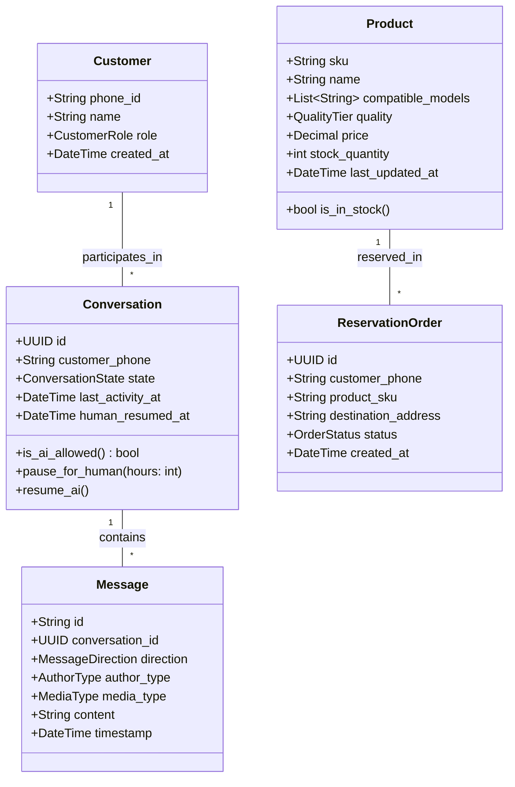
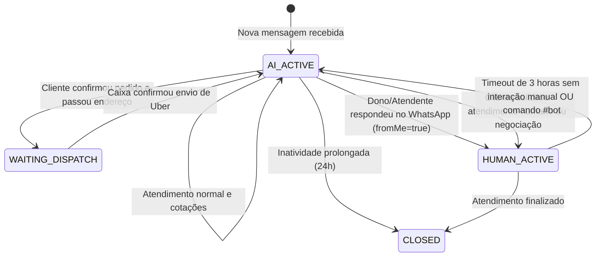
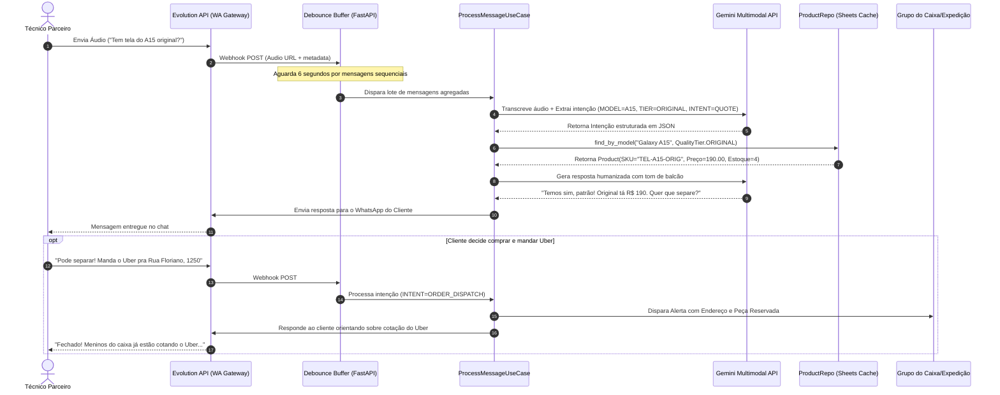

		

# RFC-002: Documento de Arquitetura de Software & Design Técnico

## Arquitetura Limpa, Entidades de Domínio e Fluxo de Integração

---

## 1. Visão Arquitetural em Camadas (Clean Architecture)

Para atender ao requisito de engenharia profissional e desacoplamento, a aplicação adota os princípios de **Clean Architecture** e **Domain-Driven Design (DDD)**. Nenhuma regra de negócio depende de frameworks web (FastAPI) ou de provedores externos (Google Sheets ou Evolution API).

```
┌──────────────────────────────────────────────────────────────────┐
│                   1. INFRASTRUCTURE LAYER                         │
│  • Evolution API Client        • Gemini Multimodal (Circuit Breaker)│
│  • Bling ERP v3 / Memory / DB  • SQLite/Postgres Async Repo      │
│  • Multi-Channel StaffNotifier • Sliding Window Rate Limiter     │
│  • Prometheus Metrics Exporter • System Clock & Scheduler (UTC-3)│
└─────────────────────────────────┬────────────────────────────────┘
                                  │ implements interfaces
┌─────────────────────────────────▼────────────────────────────────┐
│                    2. APPLICATION LAYER                          │
│  • ProcessIncomingMessageUseCase                                 │
│  • RequestProductSeparationUseCase                               │
│  • TriggerHumanHandoffUseCase                                    │
│  • MessageDebounceBufferService                                  │
└─────────────────────────────────┬────────────────────────────────┘
                                  │ orchestrates
┌─────────────────────────────────▼────────────────────────────────┐
│                      3. DOMAIN LAYER                             │
│  • Entities: Customer, Conversation, Message, Product, Order     │
│  • Value Objects: PhoneNumber, Price, QualityTier, State         │
│  • Interfaces: ProductRepositoryInterface, MessagingGateway      │
└──────────────────────────────────────────────────────────────────┘
```

---

## 2. Modelagem das Entidades de Domínio

### 2.1 Diagrama de Classes e Relacionamentos



### 2.2 Máquina de Estados da Conversa (`ConversationState`)



---

## 3. Diagrama de Sequência: Ciclo de Vida da Mensagem

O diagrama abaixo detalha o caminho percorrido por um áudio enviado por um técnico solicitando cotação e posterior despacho com o Uber:



---

## 4. Padrões de Resiliência e Desempenho

### 4.1 Estratégia de Cache de Alta Performance (Google Sheets)

Para contornar o limite de 60 requisições/minuto da API do Google Drive/Sheets:

* **In-Memory Cache (com TTL de 3 minutos):** O backend realiza uma leitura periódica do catálogo completo para a memória RAM (dicionário indexado por palavras-chave e SKUs).
* **Busca Local em Milissegundos:** As buscas de produtos feitas pelo Gemini utilizam o catálogo já carregado na memória, resultando em respostas com latência inferior a 30ms.
* **Escrita Assíncrona:** Apenas inclusões de novos pedidos e logs de auditoria disparam chamadas de escrita direta na planilha, enfileiradas de forma assíncrona (`BackgroundTasks` do FastAPI).

### 4.2 Detecção e Transbordo Transparente

A Evolution API envia eventos para o webhook tanto de mensagens recebidas quanto de mensagens enviadas.

* Quando o payload traz `"key": { "fromMe": true }`, o sistema reconhece que um operador humano usou o WhatsApp Web ou o aparelho físico da loja.
* O use case `HandleHumanInterventionUseCase` é executado, atualizando a entidade `Conversation` para `state = ConversationState.HUMAN_ACTIVE` e definindo `human_resumed_at = now()`.
* Nenhuma resposta automatizada é gerada enquanto a conversa permanecer nesse estado, garantindo que a IA nunca interfira na conversa do dono.

---

## 5. Padrões Avançados de Resiliência, Integridade e Governança

### 5.1 Circuit Breaker para Provedor de IA (Google Gemini)
Para proteger a esteira de atendimento contra picos de latência, indisponibilidade temporária na nuvem ou códigos `HTTP 429 Too Many Requests`:
* **Máquina de Estados:** `CLOSED` (operação normal), `OPEN` (interrompe chamadas ao Gemini e aciona fallback imediato com aviso cordial), `HALF_OPEN` (sondagem de recuperação).
* **Thresholds:** Abre após 3 falhas consecutivas e realiza sondagem após 30 segundos.

### 5.2 Busca Fuzzy Resiliente e Normalização de Codinomes de Fábrica
* **Levenshtein Puro:** Distância de edição sem dependências externas compiladas em C, garantindo portabilidade absoluta.
* **Tolerância a Gírias:** Mapeamento de codinomes (`t220`, `t295`, `x205`, `nb304`) para modelos comerciais Samsung e Multilaser.
* **Matriz de Discriminação:** Penalização semântica para evitar entregar display quando o cliente solicitou apenas o touch.

### 5.3 Guarda Atômica Anti-Overbooking
A dedução de estoque ocorre antes de salvar a ordem:
* Operação atômica em nível de repositório (`decrement_stock`).
* Se saldo insuficiente, o pedido é abortado com aviso ao cliente ("peça acabou de esgotar") e evento `OVERBOOKING_BLOCKED` persistido na auditoria.

### 5.4 Governança de Mudança de Preço (`PRICE_CHANGED`)
* **Sincronização Ativa:** Webhook `POST /webhook/erp/stock` atualiza catálogo e registra log imutável de alteração de preço.
* **Proteção Comercial:** Cotação sempre reflete o milissegundo atual. Em caso de contestação de valor pelo cliente, a IA é silenciada e aciona `HUMAN_HANDOFF` imediato com notificação prioritária no WhatsApp do atendente humano.

### 5.5 Governança de Pix (Transbordo Humano Silencioso)
* O bot **nunca** responde chave Pix automaticamente. Toda menção ou pergunta sobre Pix aciona transbordo silencioso para o caixa humano.
