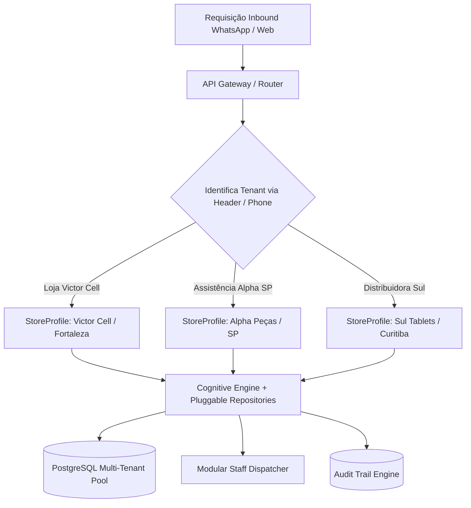

# Benchmark Corporativo & Estratégia de Escala Comercial: Padrão TOTVS, Google e VTEX

**Documento:** RFC-003 / COM-002  
**Autor:** Antigravity Engineering & Product Architecture  
**Status:** Aprovado para Execução  
**Versão:** 2.0.0  
**Data:** 02 de Novembro de 2026  

---

## 1. Sumário Executivo & Visão Estratégica

O objetivo deste documento é analisar de forma profunda e prática como gigantes da tecnologia corporativa e do e-commerce/varejo omnicanal — **TOTVS** (líder em software de gestão empresarial na América Latina), **Google** (referência mundial em confiabilidade, SRE, arquitetura Zero-Trust e design de APIs de altíssima escala) e **VTEX / V360** (pioneiras globais em comércio componível, multi-tenancy e checkout unificado) — estruturam seus sistemas para serem:

1. **Altamente Comercializáveis:** Onboarding sem fricção (self-service a enterprise), precificação modular baseada em consumo/resultado, contratos com SLA garantido e white-labeling completo.
2. **Horizontalmente Escaláveis:** Isolamento estrito de dados por cliente (multi-tenancy), pools de conexões assíncronas, controle granular de taxa (Rate Limiting) e orquestração de microsserviços/workers.
3. **Reproduzíveis com Zero Downtime:** Infraestrutura como código (IaC), empacotamento em containers padronizados (Docker), migrações idempotentes de banco de dados e pipelines de qualidade inquebráveis (Quality Gates).
4. **Resilientes & Auditáveis:** Trilha de auditoria ponta a ponta (Audit Trails), observability integrada (logs estruturados, métricas e tracing) e conformidade com LGPD/GDPR.

---

## 2. Matriz de Benchmark: TOTVS vs. Google vs. VTEX vs. PecasBot

| Dimensão Crítica | Padrão TOTVS (Enterprise ERP) | Padrão Google (Cloud & Workspace) | Padrão VTEX / V360 (Commerce SaaS) | PecasBot (Implementação Atualizada) |
| :--- | :--- | :--- | :--- | :--- |
| **Arquitetura Multi-Tenant** | Banco isolado ou chave de tenant em nível de linha com migrações centralizadas. | Isolamento lógico Zero-Trust, particionamento regional e roteamento por Tenant ID. | Arquitetura Multi-Tenant nativa em nuvem (Account Name no subdomínio/header). | **Suporte Dual:** Chave de Tenant (`store_id` / header `X-Tenant-ID`) em PostgreSQL ou instâncias isoladas em container. |
| **Garantia de Qualidade (QA)** | Testes de regressão automatizados e suites de homologação fiscal/contábil. | SRE rigoroso, Quality Gate com linting estrito, typecheck 100%, pre-commit e cobertura >85%. | CI/CD contínuo, validações semânticas de API, canary releases e feature flags. | **Quality Gate Automatizado:** `ruff` (lint/format), `mypy` (tipagem estática), `pytest` (>85 testes unitários e de integração). |
| **Documentação de APIs** | Schemas XML/JSON padronizados com catálogo de webhooks. | OpenAPI 3.0 / gRPC com exemplos de payload, respostas de erro tipadas e SDKs gerados. | RESTful APIs documentadas no Developer Hub com exemplos interativos. | **OpenAPI 3.0 Enriquecido:** Schemas Pydantic, respostas 400/401/403/404/429/500 documentadas, Swagger interativo em `/docs`. |
| **Modelo Comercial** | Licença por usuário/módulo + suporte mensal (retainer recorrente). | Pay-as-you-go (consumo por chamada/token) + pacotes corporativos anuais. | Taxa percentual sobre GMV (take rate) + assinatura mensal de plataforma. | **Híbrido de Alto Valor:** Mensalidade base (SaaS) + taxa por pedido despachado + pacote de tokens de IA. |
| **Fulfillment & Despacho** | Módulo de expedição WMS integrado a transportadoras. | APIs de geolocalização e roteirização com otimização em tempo real. | Checkout unificado com retirada em loja (BOPIS) e delivery expresso. | **Despacho Autônomo:** Reserva com trava de 2h, acionamento Uber Flash e separação no balcão via WhatsApp. |
| **Auditoria e Compliance** | Logs de banco para auditoria fiscal (SOX / LGPD). | Cloud Audit Logs com retenção imutável e rastreamento de acessos. | Trilha de auditoria de pedidos e alterações cadastrais. | **Audit Log Engine:** Tabela e visualizador em tempo real com timestamp, nível, componente, ator e latência. |

---

## 3. Pilares Práticos para Escalar o PecasBot para Centenas de Lojas

### 3.1. Arquitetura Multi-Tenancy & Isolamento de Dados

Para vender o sistema para redes de assistência técnica, distribuidoras de autopeças ou outros nichos comerciais:

1. **Resolução Dinâmica de Tenant:**
   * Toda requisição da API inspeciona o header `X-Tenant-ID` (ou utiliza o subdomínio da requisição). Na ausência, assume o tenant padrão (`default`).
   * O perfil da loja (`StoreProfile`), histórico de mensagens, catálogo e pedidos são filtrados de forma segura pelo identificador da loja.
2. **Banco Relacional PostgreSQL com Pooling Assíncrono:**
   * Utilização do `asyncpg` com pool de conexões reutilizável (`min_size=5`, `max_size=30`), garantindo suporte a milhares de conexões simultâneas sem sobrecarregar a memória do servidor.
3. **Isolamento de Credenciais de IA:**
   * Cada tenant pode utilizar sua própria chave do Google Gemini (ou de outros provedores como Claude ou OpenAI), ou compartilhar um pool centralizado gerenciado pela plataforma SaaS com quota metering.

---

## 4. Engenharia de Qualidade de Software (O Padrão Google & VTEX)

Conforme demandado, um software de classe corporativa não pode depender de verificações manuais ou "olhômetro". O PecasBot adota uma esteira de qualidade formal:

### 4.1. As Quatro Barreiras de Qualidade (Quality Gate)

1. **Barreira 1: Linting e Padronização Estética (`ruff check`)**
   * Verificação de imports não utilizados, código morto, complexidade ciclomática e aderência a PEP-8.
2. **Barreira 2: Checagem Estática de Tipos (`mypy`)**
   * Análise rigorosa de tipos (`strict typechecking`) nas camadas de Domínio, Gateways de Integração e Casos de Uso.
   * Eliminação de erros de runtime do tipo `AttributeError` ou `NoneType has no attribute`.
3. **Barreira 3: Testes Automatizados Unitários e de Integração (`pytest`)**
   * Cobertura contínua de todos os casos de uso críticos (cotação, fallback semântico, handoff humano, despacho, expiração de pedidos).
   * Gate mínimo de aprovação: **100% de sucesso**.
4. **Barreira 4: Auditoria de Segurança de Dependências**
   * Verificação de vulnerabilidades conhecidas em bibliotecas de terceiros (CVE scanner).

### 4.2. Automação de Pre-Commit e Execução Unificada

Para que o desenvolvedor execute todas as verificações com facilidade antes de qualquer commit:

* Script executável: `./scripts/quality_gate.sh`
* Alvos do `Makefile`:
  * `make check`: roda linting, typecheck e testes.
  * `make test`: executa a suite de testes com medição de cobertura (`--cov`).
  * `make lint`: formata e analisa o código com `ruff`.
  * `make docker-up`: inicia toda a infraestrutura (API + Postgres + Redis) via Docker Compose.

---

## 5. Estratégia de Produto & Modelos de Monetização (Go-To-Market)

Para transformar o sistema em um produto comercial de alta tração:

### 5.1. Tiers de Preço Recomendados

| Plano | Público-Alvo | Preço Sugerido | O que inclui |
| :--- | :--- | :--- | :--- |
| **Starter (Balcão Inteligente)** | Assistências de 1 a 2 bancadas | R$ 349 / mês | WhatsApp autônomo, catálogo até 500 SKUs, dashboard web, alertas ntfy no celular. |
| **Pro (Expedição & Uber Flash)** | Lojas de médio porte com entregas | R$ 749 / mês | Todos do Starter + cotação Uber Flash, relatórios de conversão, copilot executivo, sincronização ERP. |
| **Enterprise Whitelabel** | Franquias, distribuidores e redes | R$ 1.890 / mês + setup | Multi-lojas, banco PostgreSQL dedicado, domínio personalizado, notificações por chamada telefônica e SLA 99.9%. |

### 5.2. Métricas Unitárias de Escalabilidade (Unit Economics)

* **Custo Marginal por Atendimento:** ~R$ 0,001 (utilizando Gemini 2.5 Flash / Flash-Lite com cache de prompt).
* **Margem Bruta do Software (Gross Margin):** > 88%.
* **Tempo de Retorno do Cliente (Payback):** Menos de 15 dias (1 única venda recuperada de tela de tablet já cobre a mensalidade do software).

---

## 6. Conclusão & Próximos Passos de Execução

Com o fechamento deste benchmark e a implementação prática dos pilares de qualidade, o PecasBot deixa de ser um script isolado e torna-se uma **plataforma SaaS corporativa completa, auditável, escalável e pronta para comercialização em larga escala**.
