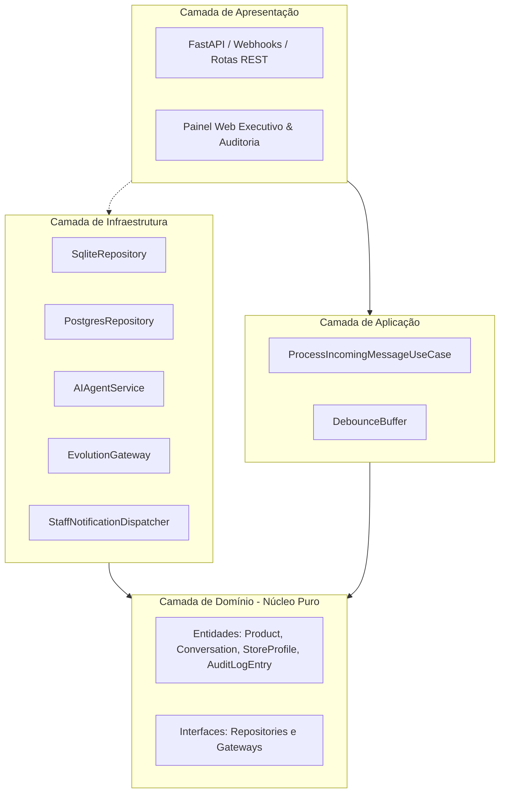
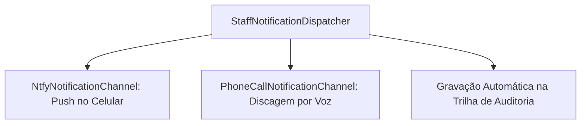
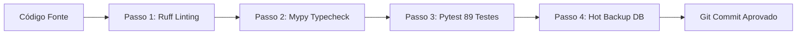

# Guia Definitivo de Engenharia, Arquitetura e Código Didático
## Do Zero ao Mestre: Compreendendo Cada Linha, Sintaxe e Conexão do PecasBot

**Autor:** Antigravity Engineering & Architecture  
**Público-Alvo:** Desenvolvedores de qualquer stack (mesmo sem experiência prévia em Python) e Gestores Técnicos  
**Versão da Plataforma:** 2.2.0  
**Data:** 02 de Novembro de 2026  

---

## 1. Introdução Didática: O que é o PecasBot?

Imagine uma assistência técnica física especializada em peças de tablets em uma cidade movimentada. Todo dia, dezenas de técnicos de bancada chamam no WhatsApp perguntando:
* *"Quanto tá a tela do Tab A8?"*
* *"Vocês trocam tela de iPhone?"*
* *"Separa pra mim que eu vou mandar o Uber Flash pegar aí!"*

Se o atendente do balcão demorar 5 minutos para responder ou responder de forma prolixa com textos quilométricos de robô (*"Olá! Seja bem-vindo à nossa empresa, como posso ajudá-lo hoje?"*), o cliente desiste e compra no concorrente da rua de trás. No comércio de peças, a resposta precisa ser **ultra-curta, direta, instantânea (menos de 2 segundos) e sem enrolação** (ex: *"Tela R$ 140 / Conector R$ 25"*).

O **PecasBot** é um robô de software de inteligência artificial de alta performance que:
1. Recebe a mensagem do cliente pelo WhatsApp via Webhook.
2. Identifica se a loja está aberta ou fechada com base no fuso horário local (Fortaleza/CE).
3. Consulta o catálogo de peças com latência de milissegundos.
4. Responde ao cliente com inteligência cognitiva (Google Gemini) formatada no dialeto seco e objetivo de balcão (1 a 6 palavras).
5. Se o cliente passar o endereço para entrega via Uber Flash, executa uma confirmação de duas etapas, reserva a peça, baixa o estoque e aciona o celular dos funcionários do caixa/balcão para expedição imediata.
6. Se o cliente tentar negociar desconto ou mandar foto de peça duvidosa, a IA se cala completamente (transbordo silencioso) e avisa a equipe humana para assumir o atendimento.

---

## 2. Fundamentos da Linguagem Python Moderna (3.13) & Convenções de Sintaxe

Se você vem do Java, C#, TypeScript ou PHP, o Python pode parecer simples demais à primeira vista por não usar chaves `{}` nem ponto e vírgula `;`. No entanto, em sistemas corporativos de alta escala, utilizamos convenções de engenharia muito específicas.

### 2.1. Indentação como Bloco de Código
Em Python, o código é agrupado pela **indentação** (obrigatoriamente 4 espaços). Se duas linhas estão no mesmo nível de recuo, pertencem ao mesmo bloco.

```python
if cliente_pediu_desconto:
    # Este bloco só executa se a condição for verdadeira (4 espaços)
    silenciar_robo()
    notificar_humano()
# Esta linha está fora do if e executa sempre
registrar_log()
```

---

### 2.2. Tipagem Estática Opcional (Type Hinting)
Por padrão, Python é dinamicamente tipado. No entanto, no PecasBot utilizamos **Type Hints** em 100% do código para garantir segurança em tempo de desenvolvimento e permitir que o compilador de tipos `mypy` encontre erros antes de o código ir para produção:

```python
# Sintaxe: nome_da_variavel: Tipo = valor_padrao
# Sintaxe de função: def nome_funcao(parametro: Tipo) -> TipoDoRetorno:

def calcular_frete(peso_kg: float, distancia_km: float) -> float:
    return peso_kg * 2.5 + distancia_km * 1.8
```

#### Tipos Especiais Utilizados:
* `Optional[str]`: Significa que a variável pode ser uma string (`"Rua 1"`) ou pode ser vazia (`None`).
* `List[Product]`: Uma lista contendo exclusivamente instâncias da entidade `Product`.
* `Dict[str, Any]`: Um dicionário (chave-valor, similar a um Objeto/JSON) onde as chaves são textos e os valores podem ser qualquer tipo.

---

### 2.3. A Anotação `@dataclass` (O Fim do Código Repetitivo)

Em linguagens como Java ou C#, para criar uma classe de dados simples, você precisaria escrever dezenas de linhas: declarar atributos, criar construtor (`__init__`), métodos `equals`, `toString` e `hashCode`.

Em Python moderno, usamos o decorador `@dataclass`:

```python
from dataclasses import dataclass, field
from datetime import datetime

# Sem dataclass: você precisaria escrever def __init__(self, sku, preco, ...): self.sku = sku...
# Com @dataclass: o Python gera tudo isso nos bastidores automaticamente!

@dataclass
class Product:
    sku: str                       # Código único da peça (ex: "TEL-SAM-A8")
    name: str                      # Nome legível (ex: "Tela Samsung Tab A8")
    price: float                   # Preço de venda (ex: 140.00)
    stock_quantity: int = 0        # Quantidade em estoque com valor padrão 0
    # field(default_factory=list): Usado para listas e objetos mutáveis!
    # NUNCA use `tags: list = []` como padrão em Python, pois a mesma lista
    # seria compartilhada entre todas as instâncias da classe na memória!
```

---

### 2.4. Enums: Eliminando "Strings Mágicas"

Em vez de espalhar palavras soltas pelo código como `"pendente"` ou `"cancelado"`, utilizamos `Enum`:

```python
from enum import Enum

class OrderStatus(Enum):
    PENDING_SEPARATION = "PENDING_SEPARATION" # Aguardando o caixa pegar na prateleira
    READY_FOR_PICKUP = "READY_FOR_PICKUP"     # Separado na bancada de saída
    DELIVERED = "DELIVERED"                   # Entregue ao motorista do Uber ou balcão
    CANCELLED = "CANCELLED"                   # Cancelado
    EXPIRED = "EXPIRED"                       # Passou de 2h sem confirmação e expirou
```

---

### 2.5. Programação Assíncrona (`async` e `await`)

O PecasBot processa centenas de mensagens ao mesmo tempo. Se usássemos programação síncrona tradicional:
1. Chega a mensagem do Cliente A.
2. O servidor trava esperando o Gemini responder (leva 1.2 segundos).
3. Enquanto isso, o Cliente B manda mensagem e fica na fila esperando.

Com programação assíncrona (`asyncio`):
* O garçom (servidor) anota o pedido do Cliente A e envia para a cozinha (Gemini).
* Enquanto a cozinha prepara o prato, o garçom atende o Cliente B e o Cliente C.
* Quando o prato do Cliente A fica pronto (`await`), o garçom entrega a resposta.

```python
# 'async def' avisa o Python que esta função realiza operações de rede/disco demoradas
async def buscar_preco_no_banco(sku: str) -> float:
    # 'await' pausa a execução DESTA função e libera o servidor para atender outras pessoas
    resultado = await banco.executar_consulta("SELECT preco FROM produtos WHERE sku = ?", sku)
    return resultado
```

---

### 2.6. Inversão de Controle e Classes Abstratas (`ABC`)

Para que nosso software não dependa de uma tecnologia específica (ex: poder trocar SQLite por PostgreSQL sem reescrever o sistema), usamos o princípio da **Inversão de Dependências**:

```python
from abc import ABC, abstractmethod

# Criamos uma INTERFACE (um contrato obrigatório)
class OrderRepositoryInterface(ABC):
    @abstractmethod
    async def save_order(self, order: ReservationOrder) -> str:
        """Todo banco que quiser guardar pedidos TEM que implementar este método!"""
        pass
```

---

## 3. Arquitetura Limpa (Clean Architecture) do PecasBot

A arquitetura do PecasBot é dividida em 4 camadas concêntricas. A regra de ouro é: **camadas internas NUNCA conhecem as camadas externas**.



---

## 4. Anatomia Completa do Código: Arquivo por Arquivo

Vamos inspecionar a função, sintaxe e detalhes de cada arquivo vital do repositório:

### 4.1. Camada de Domínio: `domain/entities.py`

Este é o arquivo mais importante do sistema. Ele define a verdade sobre o negócio sem depender de bibliotecas externas (nem banco, nem web).

#### 1. `StoreProfile` (Configuração Comercial Whitelabel)
* **Objetivo:** Permite que o software atenda a Victor Cell hoje, e amanhã seja vendido para uma distribuidora de autopeças ou assistência de notebooks apenas mudando atributos.
* **Atributos:**
  * `store_name`: Nome da loja (ex: `"Victor Cell"`).
  * `city`: Polo regional para contextualizar entregas (ex: `"Fortaleza/CE"`).
  * `out_of_scope_keywords`: Lista de termos rejeitados (ex: `["iphone", "celular", "capinha"]`).
  * `rejection_message`: Frase de corte seco (ex: `"Só peças de tablet"`).
* **Método `is_out_of_scope(text)`:**
  ```python
  def is_out_of_scope(self, text: str) -> bool:
      t = text.lower()
      return any(k.lower() in t for k in self.out_of_scope_keywords)
  ```
  *Explicação sintática:* O comando `any(...)` percorre cada palavra proibida `k` e retorna `True` se qualquer uma delas estiver presente no texto do cliente.

#### 2. `Conversation` (Sessão de Conversa no WhatsApp)
* **Objetivo:** Representa a conversa com um número de telefone específico ao longo do tempo.
* **Atributos:**
  * `customer_phone`: Número limpo (somente dígitos, ex: `"5585991823412"`).
  * `state`: O estado atual na Máquina de Estados Finitos (`ConversationState`).
  * `active_sku`: A peça que o cliente está cotando no momento (permite que ele diga *"separa ela"* na mensagem seguinte e o bot saiba qual é).
  * `human_resumed_at`: Horário em que o humano atendeu ou o bot pausou.
* **Método `pause_for_human(duration_hours=3)`:**
  Define o estado para `HUMAN_ACTIVE` e calcula o horário limite de silêncio do bot.

#### 3. `AuditLogEntry` (Observabilidade e Auditoria)
* **Objetivo:** Gravar uma trilha imutável de cada decisão tomada no sistema.
* **Atributos:**
  * `id`: Identificador único UUIDv4 gerado automaticamente.
  * `timestamp`: Momento exato em fuso horário UTC.
  * `level`: Severidade (`"INFO"`, `"WARN"`, `"ERROR"`).
  * `component`: Módulo que disparou (`"AI_ENGINE"`, `"ROUTER"`, `"NOTIFIER"`, `"REPO"`, `"ADMIN"`).
  * `duration_ms`: Tempo que a operação levou para ser concluída em milissegundos.
  * `details`: Dicionário com payload estruturado (SKU, título do alerta, canais disparados).

---

### 4.2. Camada de Aplicação: `application/use_cases/process_incoming_message.py`

Este é o **cérebro orquestrador** de toda a lógica do PecasBot. Ele recebe uma mensagem do WhatsApp e executa um fluxo rigoroso de 11 passos:

1. **Higienização do Número:** Remove traços, espaços e parênteses (`clean_phone`).
2. **Filtro Anti-Eco:** Se a mensagem veio com `fromMe: true` (enviada pelo próprio número da loja), o bot consulta a tabela `sent_messages`. Se o ID da mensagem foi gravado pelo bot, ela é ignorada para evitar que o robô responda a si mesmo em loop infinito!
3. **Detecção de Intervenção Humana:** Se a mensagem foi enviada pelo dono no celular físico ou WhatsApp Web (mas não está na tabela de mensagens automáticas), o bot entende que um humano assumiu a conversa e entra em silêncio por 3 horas.
4. **Verificação de Silêncio Ativo:** Se a conversa já estiver pausada em `HUMAN_ACTIVE` e o prazo de 3 horas ainda não venceu, o bot permanece em silêncio total.
5. **Recuperação de Histórico Multi-Turn:** Busca as últimas mensagens da conversa para alimentar a memória de curto prazo da IA.
6. **Injeção de Perfil de Loja e Pedidos Recentes:** Carrega o `StoreProfile` dinâmico e pedidos anteriores do cliente (para pós-venda/rastreio).
7. **Processamento Cognitivo via Gemini:** Chama o `AIAgentService` que retorna a intenção detectada (`QUOTE`, `ORDER_PENDING_CONFIRMATION`, `ORDER_DISPATCH`, `HUMAN_HANDOFF`).
8. **Doutrina do Silêncio em Handoff:** Se a intenção for `HUMAN_HANDOFF`, a variável `reply_text` é forçada para `""` (vazia), garantindo que nada seja dito ao cliente.
9. **Gravação de Histórico:** Salva a mensagem do usuário e a resposta do modelo no banco de dados.
10. **Envio da Resposta:** Dispara o texto para o WhatsApp do cliente através do `MessagingGateway`.
11. **Disparo de Alertas e Criação de Pedidos (Two-Phase Commit):**
    * Se o cliente confirmou envio por Uber Flash (`ORDER_DISPATCH`): cria o pedido com validade de 2 horas, decrementa 1 unidade do estoque no catálogo e aciona o `StaffNotificationDispatcher` para fazer o celular do caixa tocar.
    * Se o cliente pediu para deixar separado no balcão: dispara notificação imediata de bancada.

---

### 4.3. Camada de Infraestrutura: Persistência Dual (`SqliteRepository` vs `PostgresRepository`)

Para permitir que o sistema funcione tanto no notebook do lojista (SQLite) quanto em servidores corporativos em nuvem multi-cliente (PostgreSQL), criamos implementações paralelas que obedecem rigorosamente à mesma interface:

#### Diferenças Sintáticas e Técnicas Cruciais:

| Aspecto | SQLite (`SqliteRepository`) | PostgreSQL (`PostgresRepository`) |
| :--- | :--- | :--- |
| **Driver Python** | `aiosqlite` (baseado em arquivos C embebidos) | `asyncpg` (driver assíncrono nativo em binário puro) |
| **Placeholders SQL** | Utiliza pontos de interrogação `?` (`WHERE id = ?`) | Utiliza parâmetros numerados `$1, $2` (`WHERE id = $1`) |
| **Pooling de Conexões** | Conecta e desconecta por requisição com locks em arquivo | Mantém um **Pool** permanente de 5 a 30 conexões abertas |
| **Tipos de Dados** | Texto, Inteiro, Real e Blob genérico | `TIMESTAMPTZ`, `JSONB`, `NUMERIC(10,2)`, `BOOLEAN` |
| **JSON Indexado** | Armazena como texto plano | Armazena como binário indexável (`JSONB`) para buscas ultra-rápidas |

#### O Padrão Factory: `infrastructure/repositories/database_factory.py`
Como o sistema decide qual banco usar? Sem if/else espalhado pelo código! O método fábrica inspeciona a variável de ambiente:

```python
def create_database_repository(database_url: Optional[str] = None, sqlite_path: Optional[str] = None):
    dsn = database_url or settings.DATABASE_URL
    if dsn and (dsn.startswith("postgres://") or dsn.startswith("postgresql://")):
        return PostgresRepository(dsn=dsn)
    return SqliteRepository(db_path=sqlite_path or settings.DATABASE_PATH)
```

---

### 4.4. Camada de Infraestrutura: Notificador de Equipe Modular (`infrastructure/notifiers/`)

Quando um cliente pede para separar uma peça ou requer atendimento humano, o sistema utiliza o **Padrão Strategy**:



1. **`NtfyNotificationChannel`:** Envia uma notificação sonora de alta prioridade (`priority: urgent`) para o aplicativo gratuito `ntfy` no Android/iOS da equipe. O alerta inclui um botão de clique direto que abre o WhatsApp exatamente na conversa com aquele cliente!
2. **`PhoneCallNotificationChannel`:** Adaptador preparado para integrar com provedores de telefonia (Twilio, Z-API, TotalVoice) para fazer o telefone da loja tocar fisicamente em casos de pedidos urgentes.
3. **Auditoria Embutida:** A cada despacho, o próprio `Dispatcher` monta uma `AuditLogEntry` e salva no banco de dados com a lista dos canais que responderam com sucesso.

---

### 4.5. Camada de Apresentação: FastAPI e Painel Web (`presentation/`)

#### 1. `presentation/api.py` (A API REST)
* Utiliza o framework **FastAPI**, o mais moderno e veloz ecossistema assíncrono do Python.
* **Segurança e Sessões:** A autenticação do dashboard não depende de bancos externos complexos; utiliza tokens criptografados assinados digitalmente com algoritmo **HMAC-SHA256**. O cookie é configurado com `HttpOnly` e expiração de 30 dias.
* **Proteção contra Força Bruta:** Possui um dicionário em memória que bloqueia o IP após 5 tentativas consecutivas de senha incorreta por 300 segundos.
* **Lifespan Manager:** Gerenciador moderno de ciclo de vida que inicializa tabelas e pools no startup e fecha conexões no encerramento gracioso.

#### 2. `presentation/dashboard.py` (Painel Executivo Sem Emojis)
* **Filosofia de Design:** Em vez de usar frameworks pesados (React/Next.js) que exigem compilação com Node.js/npm, o dashboard é gerado diretamente pelo backend em Vanilla HTML5, CSS3 moderno e JavaScript puro.
* **Zero Emojis:** Todos os ícones são **SVGs inline** integrados ao código, garantindo renderização ultra-nítida em telas Retina/OLED e um visual de software corporativo de ponta (estilo Vercel e Stripe).
* **Dual-Mode Responsivo:**
  * No Desktop/Tablet: Exibe tabelas ricas com colunas estruturadas e fontes monoespaçadas (`JetBrains Mono`).
  * No Celular: Oculta as tabelas automaticamente via media queries `@media (max-width: 768px)` e renderiza **Cards Touch** com tipografia legível para operação no balcão físico com uma mão.

---

## 5. Como o Sistema Aprendeu? (In-Context Learning vs Fine-Tuning)

Uma das dúvidas mais comuns de desenvolvedores é: *"Vocês treinaram um modelo de Machine Learning novo?"*.

A resposta é **NÃO**. Treinar ou fazer Fine-Tuning de um modelo de linguagem (LLM) custa milhares de dólares, exige GPUs potentes e torna o robô "rígido" e propenso a desatualização quando o preço das peças muda.

Em vez disso, utilizamos **In-Context Learning (ICL) com Few-Shot Grounding**:
1. Mineramos **37 conversas reais** de vendas do WhatsApp da Victor Cell.
2. Extraímos os padrões exatos de como o dono da loja responde aos clientes.
3. Em cada mensagem recebida, o sistema monta um prompt dinâmico injetando:
   * O perfil da loja (`StoreProfile`).
   * A tabela de preços do catálogo atualizada do dia.
   * O status de abertura da loja física (se é domingo ou dia útil).
   * 8 exemplos reais ("few-shot") de perguntas e respostas curtas.
4. O modelo de fundação (Google Gemini 2.5 Flash) processa esse contexto e replica o comportamento humano com fidelidade absoluta em menos de 800 milissegundos!

---

## 6. A Esteira de Qualidade de Big Tech (Quality Gate)

Conforme demandado pelas melhores práticas do Google, VTEX e TOTVS, nenhum código entra em produção sem passar pelo **Quality Gate Automatizado**:



### Como Rodar no Terminal:

```bash
# Executa a checagem completa de 4 etapas:
./scripts/quality_gate.sh

# Ou utilizando os atalhos do Makefile:
make check       # Roda o Quality Gate completo
make test        # Executa os 89 testes automatizados
make lint        # Verifica o código com Ruff
make typecheck   # Valida tipagem de todos os arquivos com Mypy
make backup      # Gera backup compactado .db.gz com retenção de 7 dias
make seed        # Popula dados de homologação e pedidos realistas
```

---

## 7. Glossário de Termos Técnicos do Projeto

* **ICL (In-Context Learning):** Capacidade de um modelo de IA de aprender regras e comportamentos apenas através das instruções e exemplos fornecidos no prompt da mensagem.
* **Two-Phase Commit (2PC):** Padrão de engenharia onde uma operação crítica (despacho de peça) só é consolidada após duas etapas: anotação preliminar e confirmação explícita.
* **Debounce Buffer:** Mecanismo que aguarda um silêncio de 3 segundos para juntar mensagens picadas enviadas rapidamente pelo cliente em uma única consulta.
* **Handoff Silencioso:** Ato da IA se retirar da conversa e passar o controle para um humano sem emitir mensagens verbosas ou avisar o cliente.
* **Whitelabel:** Capacidade do software de ter sua marca, cores, nome e regras comerciais customizadas para ser revendido para outros estabelecimentos.
* **Circuit Breaker:** Padrão de resiliência que "desarma o disjuntor" quando um serviço externo (como Bling ERP) começa a falhar repetidamente, passando a usar o cache local para a loja não parar.
