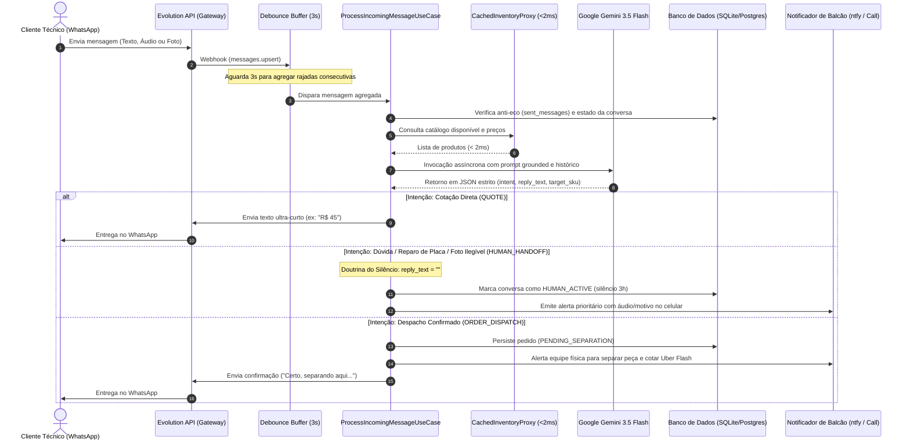
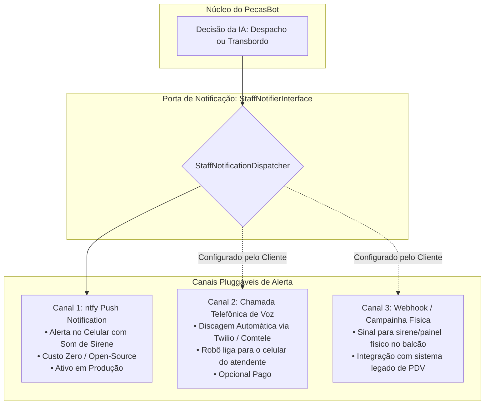

# Especificação Técnica do Módulo de Inteligência Artificial: Arquitetura Cognitiva, Mineração de Conhecimento e Fluxos de Integração
**Documento de Engenharia & Whitepaper Técnico (Padrão Google)**  
**Identificador:** AI-SPEC-001  
**Status:** Produção Homologada  

---

## 1. Taxonomia e Natureza da Inteligência Artificial

Para que a solução possa ser comercializada ou replicada em outros clientes com clareza técnica e sem ambiguidades conceituais, é fundamental esclarecer exatamente qual é a natureza da IA empregada no sistema:

```
                                TAXONOMIA DA IA
                                       │
        ┌──────────────────────────────┼──────────────────────────────┐
        ▼                              ▼                              ▼
 [APRENDIZADO DE MÁQUINA         [FINE-TUNING DE PESOS           [MOTOR COGNITIVO
     CLÁSSICO (ML)]                 NEURAIS (LLM)]           IN-CONTEXT & MULTIMODAL]
  (Regressão / XGBoost)         (LoRA / Treino de Rede)         (ARQUITETURA ATUAL)
Não atende linguagem livre.   Caro, inflexível a mudanças     In-Context Learning (ICL)
Exige datasets tabulares      diárias de preços e estoques   + Schema Estrito + Gemini Flash
estáticos.                    no balcão da loja.              + Grounding Dinâmico de Catálogo
```

### 1.1 O que a IA do PecasBot É
Trata-se de um **Motor Cognitivo Multimodal Baseado em Modelos Fundacionais (Foundation Models)**, operando sob a técnica de **In-Context Learning (ICL)**, **Few-Shot Conditioning** e **Grounding Dinâmico de Catálogo e Estado Operacional**, orquestrado via SDK oficial assíncrono `google.genai` (Google Gemini 3.5 Flash / Flash Lite).

### 1.2 O que a IA do PecasBot NÃO É
1. **Não é Aprendizado de Máquina Supervisionado Clássico (ML):** Não se trata de uma árvore de decisão (Random Forest), classificador Naive Bayes ou regressão. Esses modelos são incapazes de interpretar o português informal de técnicos no WhatsApp, gírias regionais de Fortaleza, imagens de placas quebradas ou áudios com ruído.
2. **Não é Fine-Tuning (Ajuste Fino de Pesos):** O modelo pré-treinado do Gemini **não teve seus pesos internos alterados**. No varejo de peças, o estoque e os preços flutuam diariamente. Se os preços fossem "decorados" nos pesos neurais via Fine-Tuning, qualquer alteração na tabela de preços exigiria retreinar a rede neural (custoso e lento).
3. **Não é um "NotebookLM" ou RAG Estático Puro:** O NotebookLM é uma ferramenta de síntese de documentos e anotações. O PecasBot é um **agente de decisão transacional** em tempo real com máquina de estados (FSM), capaz de cotar, validar endereços, decidir se cala ou se fala, e acionar a expedição via webhooks.

### 1.3 Por que esta Arquitetura foi Escolhida
- **Velocidade Extrema (Latência P95 < 1.2s no modelo Flash):** Resposta imediata antes do concorrente.
- **Multimodalidade Nativa:** Capacidade de analisar simultaneamente áudio de bancada (Opus/OGG) e fotos de celulares quebrados sem precisar encadear múltiplos modelos externos de OCR e Whisper.
- **Garantia de Preço com Alucinação Zero:** O catálogo real do inventário é injetado diretamente no prompt a cada mensagem. A IA só pode cotar o que existe no catálogo injetado.
- **Saída Estruturada em JSON Estrito (`response_mime_type: "application/json"`):** Elimina o risco de a IA responder texto desordenado; o retorno obedece rigidamente à estrutura de campos esperada pelo código Python (`intent`, `reply_text`, `target_sku`, `requires_staff_alert`, `destination_address`).

---

## 2. Como foi Feito o "Aprendizado": Mineração de Dados Reais de Balcão

O comportamento do PecasBot não foi inventado em uma sala de reuniões nem copiado de prompts genéricos de internet. Ele foi **extraído e minerado empiricamente de 37 diálogos reais** do WhatsApp da Victor Cell, processados pelo script de inteligência `scripts/pipeline_chat_learner.py` e persistidos em `data/mined_catalog_intelligence.json`.

### 2.1 Descobertas Contraintuitivas Reveladas pelos Dados
A análise estatística dos diálogos revelou padrões que contradizem os manuais tradicionais de chatbots corporativos:

| Padrão Convencional de Chatbot (O que NÃO funciona) | Realidade Minerada do Balcão Real (O que o PecasBot faz) |
| :--- | :--- |
| **Prolixidade:** "Olá! Seja muito bem-vindo à Victor Cell! Como posso te ajudar hoje? Digite 1..." | **Concisão Extrema (1 a 6 palavras):** "R$ 45" ou "Touch 90 / Display 180". Técnicos de bancada têm pressa e odeiam introduções longas. |
| **Desculpas de Robô:** "Desculpe, ainda sou uma inteligência artificial em aprendizado e não entendi..." | **Doutrina do Silêncio:** Se a IA tem dúvida ou se a foto está ilegível, ela **permanece em silêncio absoluto para o cliente (`reply_text: ""`)** e chama o humano no balcão. |
| **Aceitar qualquer pergunta:** Tentar responder sobre iPhone, notebook ou capinhas. | **Especialização Categórica:** "Só peças de tablet". Foco total no nicho de maior margem da loja. |
| **Criar pedidos imediatamente:** Um cliente cita um bairro e o bot já gera cobrança. | **Confirmação em Duas Fases:** Exigir validação explícita do cliente após anotação de endereço antes de acionar o Uber Flash. |

---

## 3. Arquitetura de Grounding e Engenharia de Prompt

O modelo Gemini recebe um contexto dinâmico consolidado no momento exato em que a mensagem chega. O prompt mestre é montado através de seis blocos interdependentes:

```
┌────────────────────────────────────────────────────────────────────────┐
│                        COMPOSIÇÃO DO PROMPT MESTRE                     │
├────────────────────────────────┬───────────────────────────────────────┤
│ 1. Perfil da Loja (StoreProfile)│ Nome, Nicho, Palavras Recusadas e Tom│
├────────────────────────────────┼───────────────────────────────────────┤
│ 2. Grounding Operacional & Hora│ Status (Aberto/Fechado/Domingo),      │
│                                │ Avisos determinísticos de reabertura  │
├────────────────────────────────┼───────────────────────────────────────┤
│ 3. Injeção de Catálogo Fresco  │ SKUs disponíveis, preços, qualidades  │
│    (Servido pelo Cache Proxy)  │ e indicação de gavetas físicas        │
├────────────────────────────────┼───────────────────────────────────────┤
│ 4. Histórico da Sessão (2h)    │ Últimas 8 interações (Multi-turn)     │
├────────────────────────────────┼───────────────────────────────────────┤
│ 5. Pós-Venda e Pedidos Recentes│ Ordens ativas para informar rastreio  │
├────────────────────────────────┼───────────────────────────────────────┤
│ 6. Contrato de Saída JSON      │ Schema estrito de decisão operacional │
└────────────────────────────────┴───────────────────────────────────────┘
```

---

## 4. Diagramas de Sequência e Fluxo do Sistema

### 4.1 Ciclo de Vida da Mensagem do Cliente (Debounce -> IA -> Decisão)



---

### 4.2 Arquitetura Modular de Notificação da Equipe Física (Microserviço / Messaging Pattern)

Quando a IA decide pelo transbordo ou quando um despacho é fechado, a notificação para a equipe humana **não deve ser acoplada a um único canal**. 

A arquitetura adota o padrão de **Portas e Adaptadores (Notificador de Balcão)**, permitindo chavear ou combinar canais conforme o contrato com o cliente:



---

## 5. Próximas Escolhas Arquiteturais e Roadmap da Inteligência Artificial

Para guiar a evolução do produto em novos clientes e verticais de negócio, avaliam-se três caminhos tecnológicos:

### Opção A: RAG Híbrido com Vetores (pgvector no PostgreSQL)
- **Quando usar:** Para catálogos massivos superiores a 5.000 produtos (ex: autopeças automotivas multimarcas com mais de 30.000 SKUs).
- **Como funciona:** O catálogo é indexado em embeddings vetoriais. Quando o cliente pergunta, o sistema faz uma busca por similaridade de cosseno, injetando no Gemini apenas os 10 itens mais compatíveis.
- **Vantagem:** Escalabilidade ilimitada de produtos sem estourar a janela de contexto.

### Opção B: Fine-Tuning com LoRA no Google Vertex AI
- **Quando usar:** Quando um grande distribuidor com volume superior a 5.000 mensagens/dia exigir estilo de fala extremamente proprietário e vocabulário técnico regional específico.
- **Como funciona:** Ajuste fino dos pesos finais de um modelo Gemma 2 ou Gemini usando os diálogos minerados.
- **Vantagem:** Redução no tamanho do prompt mestre e menor custo de tokens por inferência.

### Opção C: Modelos Locais Offline (Ollama / LLaMA 3.2 / Gemma 2 9B)
- **Quando usar:** Clientes com restrições extremas de privacidade de dados ou que não desejam pagar faturas de API do Google Cloud.
- **Como funciona:** Execução de um LLM quantizado em servidor com GPU dedicada na infraestrutura da própria empresa.
- **Vantagem:** Custo de inferência R$ 0,00 contínuo, sem dependência de internet externa.
