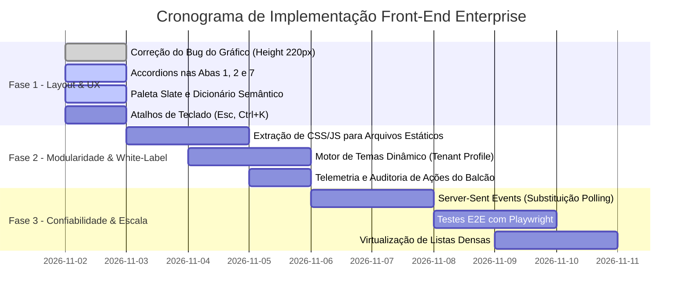

# Plano Mestre de Engenharia de Interface, UX & Arquitetura Front-End
## Victor Cell Enterprise Console • Plataforma Balcão Inteligente & ERP

**Documento:** Plano Diretor de Arquitetura de Front-End, Experiência do Usuário (UX), Escalabilidade, White-Label e Confiabilidade  
**Projeto:** Victor Cell • Balcão Inteligente & ERP (Console Administrativo)  
**Versão:** 2.0 (Atualizado com Pilares de Escalabilidade 10k+, Multi-Tenancy, Segurança, Auditoria e Testes E2E)  
**Status:** Em Execução  

---

## 1. Visão Executiva & Diagnóstico do Front-End

O back-end do PecasBot/Victor Cell atingiu um patamar de maturidade elevado (Clean Architecture, DDD, repositórios plugáveis e 25 suítes de testes unitários). Em contrapartida, a camada de apresentação do painel acumulou uma dívida técnica relevante ao concentrar mais de **4.300 linhas de HTML, CSS e JavaScript puros embutidos em uma string única** dentro de `presentation/dashboard.py`.

### 1.1 Limitações Atuais Identificadas
1. **Acoplamento Monolítico:** A interface está cravada dentro do Python, impedindo ferramentas modernas de análise estática (ESLint, Prettier, TypeScript, Tailwind) e gerando um payload desnecessário de ~200 KB enviado sem compressão ideal nem CDN.
2. **Impossibilidade de White-Labeling Imediato:** Identidade visual cravada com termos e cores da Victor Cell (`--vtex-pink: #F71963`), impedindo comercialização rápida para outras lojas e redes de assistência sem refatoração profunda.
3. **Gargalo de Concorrência & Polling:** O dashboard executa `setInterval` de 20 segundos em todos os clientes conectados. Em um cenário de 10.000 operadores/gestores simultâneos, isso geraria uma tempestade de 500 requisições/segundo sobre a base SQLite, com contenção de escrita e locks.
4. **Ausência Total de Testes no Front-End:** Há zero testes unitários para utilitários de interface (`formatPhoneBR`, cálculos de reserva) e zero testes E2E simulando as ações do balconista.
5. **Auditoria Unidirecional (Apenas Back-End):** O sistema audita eventos de banco de dados, mas não registra ações do operador na interface (quem assumiu o chat, quem consultou estoque ou quem alterou preços).

---

## 2. Os 5 Pilares de Arquitetura Enterprise

```
                               ┌──────────────────────────────────────────────────────────┐
                               │           VICTOR CELL ENTERPRISE FRONT-END               │
                               └──────────────────────────┬───────────────────────────────┘
            ┌───────────────────────────┬─────────────────┴───────────────┬───────────────────────────┐
            ▼                           ▼                                 ▼                           ▼
   ┌─────────────────┐         ┌─────────────────┐               ┌─────────────────┐         ┌─────────────────┐
   │ 1. WHITE-LABEL  │         │ 2. ESCALABILIDADE│               │ 3. SEGURANÇA &  │         │ 4. TESTES & QA  │
   │  & MULTI-TENANT │         │    (10K+ USERS) │               │    AUDITORIA    │         │  (E2E / UNIT)   │
   ├─────────────────┤         ├─────────────────┤               ├─────────────────┤         ├─────────────────┤
   │• Design Tokens  │         │• Virtual Scroll │               │• RBAC (Balcão   │         │• Playwright E2E │
   │• CSS Variables  │         │• SSE (Push)     │               │  vs Gerente)    │         │• Vitest Unit    │
   │• Feature Flags  │         │• CDN Caching    │               │• Sanitização XSS│         │• Lighthouse UX  │
   │• Dynamic Logo   │         │• Memory Release │               │• Telemetria UI  │         │• Acessib. (a11y)│
   └─────────────────┘         └─────────────────┘               └─────────────────┘         └─────────────────┘
```

---

### PILAR 1: Modularidade & White-Labeling (Multi-Tenancy)
O sistema deve ser capaz de instanciar a identidade visual e os módulos contratados de qualquer nova loja através de um arquivo de configuração ou payload JSON retornado na rota `/api/tenant/config`.

#### 1.1 Esquema de Configuração por Cliente (Tenant Profile)
```json
{
  "tenant_id": "victor_cell_matriz",
  "brand_name": "Victor Cell",
  "brand_slogan": "ERP & Balcão Inteligente",
  "theme": {
    "color_canvas": "#090D14",
    "color_surface": "#121826",
    "color_surface_elevated": "#172033",
    "color_brand_primary": "#F71963",
    "color_brand_hover": "#E00E54",
    "color_brand_glow": "rgba(247, 25, 99, 0.25)",
    "logo_url": "/static/brands/victor-cell.svg",
    "font_family": "Plus Jakarta Sans, sans-serif"
  },
  "modules": {
    "whatsapp_live": true,
    "counter_orders": true,
    "metrics_reports": true,
    "catalog_sheets": true,
    "native_erp": true,
    "copilot_ai": true,
    "audit_logs": true,
    "simulator": true
  }
}
```

#### 1.2 Injeção Dinâmica de Design Tokens (CSS Variables)
Em vez de cores hardcoded nos componentes, todos os elementos herdam estritamente as variáveis declaradas no `:root`:
```css
:root {
  --bg-canvas: var(--tenant-canvas, #090D14);
  --bg-surface: var(--tenant-surface, #121826);
  --bg-surface-elevated: var(--tenant-surface-elevated, #172033);
  --brand-primary: var(--tenant-brand-primary, #F71963);
  --brand-hover: var(--tenant-brand-hover, #E00E54);
  --border-subtle: rgba(255, 255, 255, 0.08);
}
```

---

### PILAR 2: Escalabilidade & Performance (Pronto para 10.000+ Usuários)

#### 2.1 Eliminação do Polling Brutal por Server-Sent Events (SSE)
* **Problema:** 10.000 abas abertas fazendo requisição a cada 20s = 500 req/s batendo no endpoint `/api/conversations` e travando a leitura do SQLite.
* **Solução:** Substituir o polling por uma conexão persistente HTTP unidirecional com Server-Sent Events (`/api/events/stream`):
  * O servidor só emite mensagens quando houver novo evento (novo WhatsApp, mudança de status de pedido ou alerta de estoque).
  * Redução de mais de 90% do overhead de rede e do consumo de CPU.

#### 2.2 Virtualização de Listas no Navegador (Virtual DOM / Windowing)
* **Problema:** Quando a loja acumula 10.000 atendimentos ou 5.000 peças, renderizar todos os nós HTML de uma vez congela o navegador no celular e consome centenas de megabytes de RAM.
* **Solução:** Implementar renderização em janela (virtual list). O DOM renderiza apenas os 8 a 12 cards atualmente visíveis no viewport da tela + 3 de margem superior e inferior, reciclando os nós conforme o operador rola a página.

#### 2.3 Gestão e Destruição de Instâncias de Gráficos (Memory Leak Prevention)
* Garantir que todo gráfico instanciado pelo Chart.js execute obrigatoriamente `chartInstance.destroy()` antes de recriar dados, evitando acúmulo de instâncias ocultas e vazamento de memória em sessões longas de balcão (operador com a aba aberta por 10 horas contínuas).

---

### PILAR 3: Segurança e Trilha de Auditoria no Front-End

#### 3.1 Sanitização Rígida de HTML & Prevenção de XSS
* É terminantemente proibida a interpolação direta de dados não higienizados com `innerHTML = \`...\${dado}...\``.
* Nomes de clientes vindos do WhatsApp (`pushName`), descrições de produtos e histórico de mensagens devem passar obrigatoriamente por sanitização (`escapeHtml`) antes da renderização no DOM.

#### 3.2 Controle de Acesso Baseado em Perfis (RBAC - Role-Based Access Control)
A interface deve adaptar seus painéis com base no papel do usuário logado:
1. **Perfil `BALCAO` (Balconista / Operador de Loja):**
   * Acesso liberado: Atendimentos WhatsApp, Fila de Separação de Pedidos e Busca no Catálogo.
   * Acesso bloqueado/oculto: Faturamento total, margem de lucro de custo, métricas financeiras globais e configurações de IA/Circuit Breaker.
2. **Perfil `GESTOR` (Gerente de Loja / Dono):**
   * Acesso total a KPIs, Relatórios, Copiloto de Gestão, Auditoria e Configurações de API.

#### 3.3 Telemetria de Ações do Operador (Auditoria de Front-End)
Implementar coletor assíncrono de eventos no front-end disparando contra `/api/telemetry/event`:
* `OPERATOR_VIEW_CHAT`: Operador abriu o chat de determinado cliente.
* `OPERATOR_CLAIM_CHAT`: Operador assumiu o atendimento manual da IA.
* `OPERATOR_STATUS_CHANGE`: Operador alterou o pedido de *Separando* para *Uber Flash*.
* `OPERATOR_STOCK_OVERRIDE`: Operador ajustou quantidade manual de uma gaveta.
* `UI_ERROR_OCCURRED`: Captura de exceções de JavaScript na máquina do cliente com stacktrace para diagnóstico preventivo.

---

### PILAR 4: Estratégia de Qualidade e Testes de Software

```
               ┌───────────────────────────────┐
               │    E2E Tests (Playwright)     │ ◄── Fluxo completo de balcão e login
               ├───────────────────────────────┤
               │   Component Tests (Vitest)    │ ◄── Accordions, Modais, Drawer Chat
               ├───────────────────────────────┤
               │ Unit Tests (Formatters & Utl) │ ◄── Máscaras de telefone, moeda, datas
               └───────────────────────────────┘
```

#### 4.1 Testes Unitários de Interface (Vitest / Jest)
* Cobertura das funções de utilidade essenciais:
  * `formatPhoneBR(phone)`: Suporte a telefones fixos, celulares com/sem nono dígito e números internacionais.
  * `formatCurrencyBR(val)`: Formatação monetária segura sem arredondamentos imperfeitos.
  * `formatOrderStatusBadge(status)`: Retorno semântico exato para todos os estados de máquina.
  * `calculateReservationTimer(createdAt)`: Contagem regressiva precisa dos 30 minutos sem drift.

#### 4.2 Testes End-to-End (E2E) com Playwright
Criar suíte automatizada rodando no GitHub Actions:
* **Cenário 1 (Autenticação):** Login com sucesso $\rightarrow$ Redirecionamento ao `/dashboard` $\rightarrow$ Validação de cookie HMAC $\rightarrow$ Logout.
* **Cenário 2 (Balcão de Separação):** Acesso à Aba 2 $\rightarrow$ Clique no card do pedido $\rightarrow$ Expansão do accordion $\rightarrow$ Clique em "Despachar Uber" $\rightarrow$ Confirmação de status em tempo real.
* **Cenário 3 (Chat ao Vivo):** Abertura do Drawer de Chat $\rightarrow$ Envio de mensagem manual $\rightarrow$ Toggle do status "IA Ativa" para "Balcão Manual".
* **Cenário 4 (Responsividade Mobile):** Viewport 375x667 $\rightarrow$ Clique no hambúrguer $\rightarrow$ Abertura suave da barra lateral off-canvas $\rightarrow$ Fechamento com toque no backdrop.

#### 4.3 Auditoria Automatizada de UX & Acessibilidade (Lighthouse CI)
* Métricas obrigatórias de aprovação no pipeline:
  * **Performance:** $\ge 90$
  * **Accessibility (a11y):** $\ge 95$ (Contraste de cores WCAG AA, tags ARIA em botões sem texto, navegação 100% acessível por teclado).
  * **Cumulative Layout Shift (CLS):** $< 0.05$ (Eliminar saltos de layout durante o carregamento de imagens ou gráficos).

---

### PILAR 5: Ergonomia de UX Especializada para Balcão Inteligente

O operador de balcão atende clientes físicos na loja física enquanto atende técnicos no WhatsApp. A interface precisa ser desenhada para **agilidade com zero atrito**:

#### 5.1 Sistema de Atalhos Rápidos de Teclado
* <kbd>Ctrl</kbd> + <kbd>K</kbd> ou <kbd>/</kbd>: Foco instantâneo na barra de busca do catálogo de peças.
* <kbd>F2</kbd>: Abrir modal de cadastro de nova peça no estoque.
* <kbd>F4</kbd>: Focar na fila de pedidos pendentes para entrega.
* <kbd>Esc</kbd>: Fechar qualquer gaveta lateral (Drawer), modal ou pop-up aberto.

#### 5.2 Micro-Interações & Estados de Feedback (UI Otimista)
1. **Skeleton Loaders:** Em vez de telas vazias ou ícones giratórios genéricos, exibir silhuetas pulsantes cinza-escuro com a estrutura dos cards sanfona, mantendo o olho do operador focado.
2. **Atualização Otimista (Optimistic UI):** Ao clicar em "Assumir Atendimento", o botão muda imediatamente para "Liberar p/ IA" com feedback de clique tátil; a requisição HTTP ocorre em segundo plano. Se houver falha de rede, a ação é revertida com notificação sonora discreta e toast de alerta.
3. **Indicador de Conectividade:** Banner flutuante no topo avisando caso a conexão caia: *"Modo Offline: Reconectando ao servidor..."*.

---

## 3. Correções Imediatas de Layout & Viewport (Fase 1)

### 3.1 Resolução do Bug Crítico do Gráfico de 200% da Tela (Aba 3)
* **Causa Raiz:** O Chart.js calcula a proporção do canvas com base no container pai. Se o elemento pai não possui `height` ou `max-height` explicitamente declarado no CSS, o redimensionamento da janela entra em loop de recálculo recursivo, inflando a altura do canvas para mais de 1000px.
* **Correção Obrigatória:**
  1. Envolver todos os `<canvas>` em containers dedicados:
     ```html
     <div class="chart-canvas-wrapper">
       <canvas id="chartQuality"></canvas>
     </div>
     ```
  2. Aplicar CSS estrito:
     ```css
     .chart-canvas-wrapper {
       position: relative;
       height: 220px;
       max-height: 220px;
       width: 100%;
       overflow: hidden;
     }
     ```
  3. Definir globalmente nas opções do Chart.js:
     ```javascript
     options: {
       responsive: true,
       maintainAspectRatio: false,
       // ...
     }
     ```

### 3.2 Paleta de Cores Slate Executiva & Contraste
Substituição da mistura desordenada de tons pela paleta estruturada em 3 camadas HSL:
* **Superfície Base (Dark Slate):**
  * Canvas: `#090D14`
  * Sidebar: `#0D121D`
  * Cartões & Cards: `#121826`
  * Cards Elevados / Hover: `#172033`
  * Bordas Sutis: `rgba(255, 255, 255, 0.08)`
* **Acento Executivo & Foco de Ação:**
  * Primária: `#F71963` (ou cor personalizada do cliente)
  * Hover: `#E00E54`
  * Glow: `rgba(247, 25, 99, 0.25)`
* **Feedback Semântico Padronizado:**
  * Sucesso / Confirmado: `#10B981` (Texto `#34D399`, Fundo `rgba(16, 185, 129, 0.12)`)
  * Atenção / Reserva 30min: `#F59E0B` (Texto `#FBBF24`, Fundo `rgba(245, 158, 11, 0.12)`)
  * Erro / Ruptura: `#EF4444` (Texto `#F87171`, Fundo `rgba(239, 68, 68, 0.12)`)
  * Em Rota Uber: `#6366F1` (Texto `#818CF8`, Fundo `rgba(99, 102, 241, 0.12)`)

---

## 4. Guia de Implementação Tela a Tela (As 9 Abas)

### Aba 1 • Atendimentos WhatsApp
* **Topo:** Contadores de volume de chats, campo de busca com debounce (300ms) e filtro rápido em pílula (*Todos*, *IA Ativa*, *Balcão Manual*).
* **Estrutura Sanfona (Accordion):** Cada item é um card compacto. Ao clicar, expande revelando histórico recente e botões rápidos.
* **Drawer Lateral:** Abre do lado direito com largura responsiva (440px desktop / 100vw mobile), contendo balões WhatsApp autênticos e área de envio rápido.

### Aba 2 • Separação de Peças & Balcão de Saída
* **Fila de Pedidos em Cards Sanfona (Estilo Delivery de Balcão):**
  * Eliminar tabelas com 7 colunas minúsculas.
  * Topo do card: Número do Pedido (`#104`), Modalidade (Tag azul para `Retirada Balcão`, âmbar para `Uber Flash`), Valor em destaque (`R$ 130,00`).
  * Linha de Status em Português: `✓ Separando / Confirmado`, `⏳ Aguardando Confirmação`, `🚗 Em Rota Uber`.
  * Tag de Alerta de Reserva: `⏰ Reserva garantida até 12:45 (30 min sem overbooking)`.
  * Sanfona de Detalhes: Exibe endereço completo de entrega do Uber ou observações do técnico da oficina.

### Aba 3 • Métricas & Relatórios
* **Linha 1:** 4 Cards de KPI consolidados com tipografia legível e ícones suaves.
* **Linha 2:** Categorização das demandas do WhatsApp (Cotações, Pedidos Fechados, Rupturas, Transbordo, Fora de Escopo).
* **Linha 3:** Grid 2x2 com os 4 gráficos protegidos por wrapper travado em 220px.

### Aba 4 • Catálogo de Peças
* Botão sanfona retrátil: `[📊 Visualizar Planilha Google Sheets Integrada]`. Ao clicar, a planilha expande suavemente com animação de slide; ao recolher, a tela fica totalmente limpa.
* Grade de produtos com chips de busca instantânea (Samsung, Motorola, Xiaomi, Apple) e cards com SKU, Aro, Qualidade e Preço de balcão.

### Aba 5 • ERP & Estoque Nativo
* Modal com validação em tempo real para adicionar peça (`+ Nova Peça no Estoque`).
* Resumo de inventário com valor total de estoque e alertas de reposição urgente.

### Aba 6 • Copiloto de Gestão
* Chat corporativo conectado ao banco para responder perguntas gerenciais em linguagem natural com gráficos e resumos em cards executivos.

### Aba 7 • Auditoria & Observabilidade
* Timeline de eventos com ícones semânticos, timestamp preciso e accordion sanfona revelando o payload JSON técnico apenas para quem precisar depurar.

### Aba 8 • Perfil da Loja & Diretrizes
* Painel sanfona com horários de funcionamento, regras de fechamento dominical e Golden Dialogues (padrões canônicos de balcão).

### Aba 9 • Simulador WhatsApp & Motor de IA
* Monitoramento de saúde dos modelos de IA (`Gemini 2.5 Flash`, `Gemini Multimodal Audio Native`, `Fast FAQ Cache` e `Circuit Breaker`).
* Sandbox visual com balões interativos para testar cotações e prompts antes de subir para clientes reais.

---

## 5. Dicionário de Terminologias no Front-End

| Termo Técnico / Legado | Termo Recomendado no Front-End | Contexto de Uso |
| :--- | :--- | :--- |
| `CONFIRMED` | **✓ Separando / Confirmado** | Status do pedido pronto para embalagem. |
| `WAITING_CONFIRMATION` | **⏳ Aguardando Confirmação** | Pedido aguardando aprovação ou pagamento. |
| `DISPATCHED_UBER` | **🚗 Em Rota Uber Flash** | Peça entregue ao motorista para despacho. |
| `DELIVERED` | **📦 Entregue / Concluído** | Peça retirada no balcão ou entregue na oficina. |
| `CANCELLED` | **✕ Cancelado** | Pedido expirado ou cancelado pelo cliente. |
| `Ruptura física de estoque` | **Peças Esgotadas (Sem Saldo)** | Peças com estoque zerado no momento. |
| `Validade Reserva` | **Reserva de Estoque (30 min)** | Prazo de proteção anti-overbooking. |
| `Fallback 1.5 Pro` | **Fast FAQ Cache (0ms)** | Cache local de alta velocidade em caso de instabilidade. |

---

## 6. Matriz de Responsividade & Breakpoints

| Dispositivo | Largura (px) | Barra Lateral (Sidebar) | Grade de Gráficos e Cards | Modais e Drawers |
| :--- | :--- | :--- | :--- | :--- |
| **Smartphone** | `< 640px` | Oculta por padrão; drawer sobreposto com botão hambúrguer. | 1 coluna única (`1fr`), gráficos travados em `180px`. | Largura total `100vw`, botões de ação fixos no rodapé. |
| **Tablet** | `640px - 1024px` | Modo compacto ou retrátil com toggle suave. | 2 colunas (`repeat(2, 1fr)`), gráficos travados em `200px`. | Largura máxima `90vw`, centralizados. |
| **Desktop / Monitor** | `> 1024px` | Fixa à esquerda (`width: 270px`), sticky com scroll próprio. | Grid 2x2 para gráficos, 4 colunas para KPIs (`220px` max-height). | Modais centralizados de `580px` a `720px`. |

---

## 7. Roadmap de Execução Passo a Passo



Este plano mestre atua como o documento canônico de referência para todas as fases de refatoração do front-end do Victor Cell Enterprise Console.
